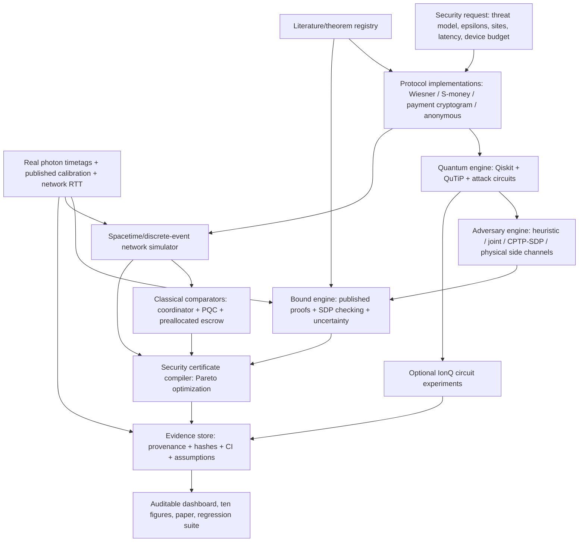

# QMINT — Proof-Carrying Quantum Payments
## A research-grade, adversarially tested platform for unclonable money, noise-tolerant quantum tokens, and relativistic payment verification

**Master implementation and research specification · Version 1.0 · 11 October 2026**  
**Ambition:** A defensible open-source security research platform, independently reproducible experimental paper, and modular technology foundation. **Not a hackathon-only demonstration, production payment system, or claim of an unearned quantum advantage.**  
**Inspired structurally by:** `genqai-implementation-plan.md` (GenQAI's frozen contracts, agent lanes, validation gates, strong baselines, ablations, evidence accounting, and honest negative results). The cryptographic protocols, proofs, baselines, and claims below are specific to QMint.  
**Core invention to investigate, NOT an established achievement:** a *security-certificate compiler* that converts measured quantum-channel conditions, a formal adversary model, a desired security level, and a geographical transaction network into a Pareto-optimal, auditable quantum-token configuration with traceable analytic or certified-numerical bounds.

> **Research thesis:** Can a quantum payment system provide a verifiable combination of unforgeability, privacy, and low-latency local validation under a precisely defined trust/space-time model, at a quantifiable cost in photons, issuance time, bandwidth, hardware assumptions, and honest-transaction failures? Can automated, uncertainty-aware parameter selection materially improve that security-resource frontier over published parameter choices and strong classical alternatives?

---

## 0. Non-negotiable rules and live tracker

### What success means

There are **three separate achievements**, requiring **three different kinds of evidence**:

1. **Cryptographic/security advantage:** quantum information gives a security property under a specified adversary and verifier model; justify with a published proof faithfully reproduced, a new independently reviewed proof, or a tightly bounded certified finite-dimensional computation. A statevector demonstration by itself proves no security against unrestricted adversaries.
2. **Systems/communication advantage:** under matching topology, trust, privacy, availability, and pre-distribution assumptions, a quantum token permits fast local validation without the same cross-site coordination as an online classical system. This is a constrained communication result, **not** a speedup in quantum computational throughput.
3. **Engineering/resource improvement:** a parameter compiler saves photons, total authenticated bits, issuance time, false rejects, or deployment costs over an explicit reference protocol **without worsening the stated security level**. This last improvement is QMint's proposed publishable contribution. It must be measured; it cannot be assumed.

**Never say:** a software simulation has implemented physically unclonable cash; no-cloning alone proves a deployed payment system is secure; classical post-quantum cryptography is broken; a synthetic network has measured real latency; Wiesner, S-money, the 2023 quantum-digital payment scheme, and 2025 anonymous tokens are one composable protocol; a numerical SDP without valid error control is a formal proof; or a free quantum simulator confers a real-hardware security certification.

### Execution policy

- Operate in a **new, dedicated** repository `qmint-research/`. Do not modify GenQAI, QC-TRADE, or another agent-org repository. Discover actual project paths rather than guessing.
- The lead orchestrator is the only writer to `main`, only merger, and only agent allowed to update `project/TRACKER.yaml` directly. Agents work in independently owned feature branches/worktrees. **No agent pushes or force-pushes**, cleans unknown files, or modifies another lane's branch.
- Before dispatch, freeze all interface contracts in §5, create tests for representative fixtures, commit a bootstrap SHA, and announce it to every agent.
- Live tracker is **truthful**: initial status `OPEN` for every task; `CLAIMED` with owner/branch/start SHA; `IN_REVIEW` with test evidence; `MERGED` with merge SHA; `BLOCKED` with exact blocker and alternative. Never mark a task done from a reassuring message alone.
- Use TDD when possible, deterministic test seeds, a small smoke dataset, and a separately frozen evaluation set. Every figure must be generated from versioned experiment records and must state whether observations are real, digitized from a paper, synthetic, or theoretically computed.
- No deployment of monetary value, real payments, expenditure of paid quantum credits, public publication, credential sharing, or claims of production security without explicit human approval.
- Perform public research and protocol analysis; do not attempt access to any real third-party payment account or live authorization system.

### Priority-ordered work ledger (initialize in `project/TRACKER.yaml`)

| ID | Lane | Key deliverable | Depends on | Priority | Initial status |
|---|---|---|---|---|---|
| A1 | Literature | Protocol/proof register, novelty audit, license register | Contracts | P0 | OPEN |
| B1 | Protocols | Exact ideal Wiesner issuance/verify test vectors | Contracts | P0 | OPEN |
| B2 | Protocols | Paper-faithful two-site S-money reference implementation | A1, contracts | P0 | OPEN |
| C1 | Adversary | Security games, classical attacks, 1→2 coherent-cloner SDP | B1, contracts | P0 | OPEN |
| D1 | Proofs | Analytic bound checker, robust acceptance, proof obligations | A1, B1 | P0 | OPEN |
| E1 | Data | Zenodo 2023 raw photon timetags + provenance + validation | Contracts | P0 | OPEN |
| F1 | Quantum | Qiskit/Aer token circuits and shot/noise tests | B1, contracts | P0 | OPEN |
| G1 | Network | Spacetime model, event-driven two-site simulation | B2, contracts | P0 | OPEN |
| H1 | Classical | Classical cash/ledger/PQC/escrow baselines | G1, contracts | P0 | OPEN |
| I1 | Compiler | Certified-parameter search with honest/security/resource constraints | D1, E1, G1 | P1 | OPEN |
| J1 | Backend | Optional Qollab/IonQ execution + measured provenance | F1 | P1 | OPEN |
| K1 | UX | Reproducible dashboard, evidence cards, plots and exports | Contracts | P1 | OPEN |
| L1 | Integration | E2E reproducible pipeline, CI, release engineering | All P0 | P0 ongoing | OPEN |
| M1 | Red team | Independent adversarial protocol/code/data audit | B–I | P1 | OPEN |
| N1 | Paper | Benchmark paper, limitations, replication capsule, demos | All gates | P1 | OPEN |
| O1 | Frontier | Anonymous classical-verification token reading/replication | A1, G4 | P2 | OPEN |
| O2 | Frontier | Public-key/lightning feasibility and cryptanalysis survey | A1, G4 | P3 | OPEN |

### Gate summary

- **G0 (integrity):** security model and schemas frozen; reproducible imports and smoke fixtures; no secrets.
- **G1 (cryptographic correctness):** one-note/two-note ideal Wiesner exact theoretical check; independent verified 1-qubit SDP optimum; honest verification tests.
- **G2 (protocol fidelity):** 2-site S-money reference matches the specified 2022 protocol steps/assumptions; site privacy and validation events use causal timestamps.
- **G3 (real evidence):** real 2023 dataset can be fetched, checksummed, decoded, and used to reproduce at least one declared figure/table; synthetic data kept separate.
- **G4 (trust-matched classical comparison):** classical coordinator, optimistic preallocation, and PQC baselines reproduced with matching topology and threat conditions.
- **G5 (compiler):** formal constraints never violated; stronger or equally strong security at lower measured resource cost on at least one frozen test setting, **or negative result reported**.
- **G6 (hardware):** optional real quantum processor run for the primitive with measured counts, backend identifier, timestamp, job ID, and uncertainty. Passing G6 is not required for the claim about full photonic money.
- **G7 (publication):** independent agent review of every equation and claim, all artifacts replay on a clean machine, licenses and data provenance resolved, pre-registration and holdout maintained.

---

## 1. Why QMint is fascinating — and what quantum really changes

A classical file can always be copied bit for bit; whether a copied digital token can be *redeemed twice* depends on the verifier's state, online synchronization, trusted hardware, cryptographic assumptions, legal recourse, and settlement architecture. Quantum information cannot be perfectly cloned when its unknown states are drawn from a nonorthogonal ensemble, but **that is only the beginning of a security proof**: practical protocols must handle verifier leakage, finite-size sampling, adversarial collective operations, honest errors, loss, timing, authentication, and insider threats.

The strongest question is not “Can we mint fake-proof quantum coins?” It is:

> **Can we build an auditable bridge from quantum no-cloning theorems to concrete payment-system security guarantees, then determine when the resulting system is genuinely better than a carefully designed classical counterpart?**

That bridge is missing from most small educational quantum-money demos. It demands *mathematical proofs, unrestricted adversary optimization where tractable, real photonic evidence, relativistic network semantics, strong classical protocols, and uncertainty-aware device optimization*. QMint will combine these in one open and inspectable lab.

### Four **distinct** protocol families (never merge their proofs by analogy)

| Family | What it accomplishes | Required assumptions and hardware | QMint role |
|---|---|---|---|
| **Wiesner private-key quantum banknotes** | Secret BB84-state notes; exact single-copy-to-two-copies counterfeiting theorem in an ideal verification game | Issuer holds secret state descriptions; unknown quantum state reaches a verifier; suitable quantum storage/transport may be required depending on scenario | First correctness/security oracle; elementary attacks and SDP |
| **Relativistic S-money / S-tokens** | Near-local validation at designated spacetime points, with strong unforgeability and privacy under the published model | Distributed trusted agents, short-range quantum preparation, authenticated classical channels, precise timing, specific pre-distribution | **Primary systems research**: local validation vs classical cross-checking |
| **Quantum-digital payment cryptograms (2023)** | Uses quantum light to create one-time classical cryptograms, with a bank involved in final verification | Photonic source/detectors, trusted setup and specified MAC/channel model, explicit finite-key and loss assumptions | **Primary real-data track**, independent protocol family, not equivalent to S-money |
| **Anonymous tokens with classical verification (2025)** | Addresses tracking by the issuer; classical bill validation after a quantum preparation step in a specific new construction | New auditing/privacy assumptions and its own proof and protocol | Separate research extension after initial gates pass |

A **public-key** quantum money or quantum lightning system is a fifth, distinct and substantially harder research track. Ordinary BB84 money cannot be made public-key by publishing its secret bases. Public-key quantum-money proofs based on group actions use computational/model assumptions and have different attack surfaces. Never market the private-key demo as public-key or decentralized digital cash.

### Novelty discipline

All of the following already exist in research: Wiesner quantum money; optimal one-note counterfeiting bound; S-money; practical S-money noise/loss analyses; experiment demonstrating distributed transaction-time advantage; experimental quantum-digital payments with real photon data; anonymous quantum tokens with classical verification. **Reproducing these is valuable infrastructure, not a new theorem.**

The potentially publishable work is a rigorously audited **security-certificate compiler + cross-protocol benchmark** that solves a previously explicitized optimization problem: given observed source/channel uncertainties and geographic needs, return the cheapest admissible protocol parameters with independently checkable cryptographic proof references and operational assumptions. An A-lane novelty audit must find prior security parameter optimization and existing certification tools before this is claimed as new. If an equivalent tool exists, benchmark it and redefine our genuine advance (e.g. uncertainty-aware confidence bounds, finite-data calibration, falsification against optimal attacks, or protocol-independent threat matching).

---

## 2. Research literature, source code, and data to exploit

### Papers (read proofs and supplementary materials, not just abstracts)

**P01 — Molina, Vidick & Watrous, 2012: Optimal counterfeiting attacks and generalizations for Wiesner's quantum money.** https://arxiv.org/abs/1202.4010. Primary source of the exact `(3/4)^n` theorem for a *particular simple counterfeiting game*. Also a distinct classical-verification variant with exact `(3/4 + sqrt(2)/8)^n` two-verification success. The original theorem is not a bound against every imaginable adaptive protocol attack.

**P02 — Kent, 2019: S-money: virtual tokens for a relativistic economy.** https://pmc.ncbi.nlm.nih.gov/articles/PMC6545040/. Define the target spacetime transaction, distributed agents, local validation, summoning, privacy, and pre-coordination. Reproduce its security/communication scenario exactly and record which assumptions give the claimed advantage.

**P03 — Kent, Lowndes, Pitalúa-García & Rarity, 2022: Practical quantum tokens without quantum memories and experimental tests.** https://www.nature.com/articles/s41534-022-00524-4. **Implementation-critical:** Table 1/2/3 protocol steps, Table 5 imperfections, Table 6 technological assumptions, Lemma 1 ideal two-site bound, finite-size security analysis and supplemental proofs. Do not transplant the ideal bound into a noisy setting.

**P04 — Schiansky et al., 2023: Demonstration of quantum-digital payments.** https://www.nature.com/articles/s41467-023-39519-w. Experimental 641-m urban-fiber quantum-digital payment, loss/error security analysis, attack-model SDP, downloadable real photon datasets and accompanying published analysis code. **Also inspect its 21 August 2023 correction:** https://www.nature.com/articles/s41467-023-40866-x before reproducing numerical claims.

**P05 — Jiang et al., 2024: Experimental practical quantum tokens with transaction time advantage.** https://arxiv.org/abs/2408.13063. Reproduce setup and stated security assumptions; reports experimentally compared transactions over 2.77-km and 60.54-km links. This is **prior art** for a quantum communication-time advantage — QMint must improve parameterization or evidence quality instead of pretending it originated the advantage.

**P06 — Gavinsky, Gilboa, Jain, Maslov & McClean, 2025: Anonymous Quantum Tokens with Classical Verification.** https://arxiv.org/abs/2510.06212. A separate contender for the frontier lane: issuer-tracking audit + classical verification, not automatically composable with S-money.

**P07 — Kukharchyk et al., 2026: Practical quantum tokens: challenges and perspectives.** https://arxiv.org/abs/2602.10621. Reality check on memories, photonics, physical vulnerabilities and positioning relative to post-quantum cryptography.

**P08 — Zhandry, 2023/2025: Quantum Money from Abelian Group Actions.** https://arxiv.org/abs/2307.12120. Public-key and quantum lightning extension only, with generic-model / group-action assumptions; not an implement-and-deploy promise.

**P09 — Cryptanalysis of Three Quantum Money Schemes.** https://arxiv.org/abs/2205.10488. Security reviewer reading; stress-testing attractive but false cryptographic constructions.

**P10 — Anonymous Public-Key Quantum Money and Quantum Voting.** https://arxiv.org/abs/2411.04482. Optional forward-looking anonymity/public verification track.

**P11 — Noise-tolerant public-key quantum money from a classical oracle.** https://arxiv.org/abs/2407.06463. Theory-only comparison; check proof model, oracle and feasibility.

**P12 — Public-Key Quantum Money and Fast Real Transforms.** https://arxiv.org/abs/2503.18890. Optional alternative for complexity/gate-cost comparison in extended public-key research.

Every source gets a record: `id, canonical_link, authors, publication_date, version, correction_status, precise_theorem, input_model, verifier_model, adversary_capabilities, tested_parameters, proof_dependencies, datasets, code, license, limitations, what_QMint_adds`. Create `research/PRIOR_ART_MATRIX.csv` and `research/THEOREM_REGISTRY.yaml`. If a reference changed since the literature snapshot, explicitly flag and reconcile.

### Public empirical datasets (real observations, not “quantum data” invented by an emulator)

1. **Schiansky et al. 2023 photonic timetags:** https://doi.org/10.5281/zenodo.7979319 ; source is a ZIP containing actual experimental timetagger events, approximately 153 MB on the observed v1 record. Schema describes `<uint8 channel> <double photon arrival time ns>`; bank H/V/+/- channels vs client outcome channels. Check exact archive formatting by inspection. Download via a consented network environment, check Zenodo version and hashes, stream/decode, estimate coincidences, observed errors/loss and uncertainty. Never expose actual payments (dataset is a physics experiment).
2. **Authors' published analysis code:** https://doi.org/10.5281/zenodo.8020667. The journal explicitly identifies this code DOI; inspect actual availability and license, pin the exact content and reproduce a reference figure if accessible. The code endpoint was not accessible in our initial browser check; do not misrepresent it as already cloned or audited.
3. **2022/2024 paper tables and supplementary empirical parameters:** not a substitute for event-level raw data. Extract data from author-provided supplements if available; otherwise label as `published_aggregate` or `digitized_figure` with digitization error. Cite exact table, figure and version.
4. **RIPE Atlas public network measurements:** https://atlas.ripe.net/docs/apis/ and https://github.com/RIPE-NCC/ripe-atlas-bigquery. Select public ping/trace measurements and document which sites are actually measured. RTT is not directly a guaranteed one-way path delay; use paired estimates and explicit assumptions. Keep empirical RTT series separate from theoretical propagation bounds.
5. **Open benchmarking fixtures:** deliberately generated BB84 test vectors, noisy synthetic channels, and random topology cases with clear synthetic labels; they are fixtures for correctness/stress, never “experimental proof.”

### Open-source projects (prefer integration over rewriting)

| Repo/tool | URL | Use | Caution |
|---|---|---|---|
| Qiskit | https://github.com/Qiskit/qiskit | Quantum circuits, prepare/measure BB84, transpilation | Pin tested version and bit-order convention |
| Qiskit Aer | https://github.com/Qiskit/qiskit-aer | Ideal/density-matrix and calibrated noisy circuits | Modelled noise != real photonic security |
| QuTiP | https://github.com/qutip/qutip | Kraus channels, quantum states, density matrices, adversary models | Small dense systems scale exponentially |
| CVXPY | https://github.com/cvxpy/cvxpy | Primal/dual SDPs for optimal attacks and parameter optimization | Numerical SDP value != machine-checked theorem |
| SCS | https://github.com/cvxgrp/scs | Accessible SDP solver | Numerical tolerance/error reporting required |
| SeQUeNCe | https://github.com/sequence-toolbox/SeQUeNCe | Photonic-network/device simulation, discrete event modeling | Protocols must be ported explicitly; no built-in S-money proof |
| QuNetSim | https://github.com/tqsd/QuNetSim | Optional alternate quantum networking backend | Inspect maintenance, compatibility and limits |
| QMoney (third party) | https://github.com/runeape-sats/qmoney | Baseline/attack model reference and independent implementation comparison | Clearly private-key, verify-and-remint; NOT public quantum cash |
| SimQN | https://github.com/QNLab-USTC/SimQN | Optional large network test | GPLv3 integration implications; prefer loose coupling |
| Open Quantum Safe / liboqs | https://github.com/open-quantum-safe/liboqs | Strong post-quantum classical cryptographic baselines | PQC is computationally secure, not broken by known scalable quantum attack |
| liboqs-python | https://github.com/open-quantum-safe/liboqs-python | Python harness for standardized signature baselines | Check platform build and supported variants |
| Qiskit IonQ | https://github.com/qiskit-community/qiskit-ionq | IonQ circuits/noisy simulator and optional hardware | Verify access, mid-measurement support, cost and native gates |
| RIPE Atlas BigQuery | https://github.com/RIPE-NCC/ripe-atlas-bigquery | Real classical network observations | BigQuery may incur charges; prefer free REST samples |

**Policy:** code is not automatically free to copy just because a repo is public. Verify the *exact commit and license*, include author/license notices, list unadopted references, and document incompatibilities in `ATTRIBUTION.md`. Some datasets and research code may have different licenses or patent implications; audit before redistribution. Prioritize reproducibility and legally clean original integration, not maximum library count.

---

## 3. Frozen scientific definitions and proof obligations

### 3.1 Security is a game, not a screenshot

Use named, versioned cryptographic experiments. All probabilities are conditioned on **the exact experiment definition** and the published/theoretical assumptions. Every claim must identify which experiment it addresses.

**Game W1 — Wiesner simple counterfeiting.** A challenger samples a secret `n`-qubit BB84 product state uniformly; the adversary obtains **one** legitimate note and may apply an arbitrary quantum channel to output two candidates, with no additional adaptive access to the secret verifier. The challenger verifies both candidates independently using the hidden preparation bases and outcomes. The attacker wins only if **both** are valid. Ideal, exact-verification theorem (Molina–Vidick–Watrous):

\[
P_{\mathrm{two\ valid}}^{\mathrm{opt}}(n)=\left(\frac34\right)^n.
\]

This equation is an **existing published theorem**, not our invention. It is valid for the specified simple-counterfeiting game. It must not be rebranded as an unconditional bound against a bank API that leaks acceptance information, partial tokens, repeated verification attempts, an unknown noise threshold, or adaptive interactions. For the paper's *distinct classical-communication verification variant* the published bound is `(3/4 + sqrt(2)/8)^n`; that variant needs a separate test and proof record.

**Game W2 — noisy/tolerant banknote.** Replace exact accept-all-qubits with a precisely defined threshold, loss/reporting policy, channel, and verifier. Redefine honest rejection and adversarial success. The formula `(3/4)^n` does **not** automatically hold. First compute honest acceptance under a model; then obtain an actual adversarial upper bound from a matching theorem or an auditable SDP at tractable sizes. A heuristic counterfeit attack success estimate is only a *lower bound* on worst-case attacker success, not a security certificate.

**Game S1 — ideal two-site S-token.** Use the two-site ideal protocol (and names, assumptions, state ensemble) of Kent et al. 2022. In that model the stated dual-acceptance bound is

\[
\epsilon_{\mathrm{unf}}=\left(\frac12+\frac{1}{2\sqrt2}\right)^N.
\]

This is **not** Wiesner's 3/4 bound. For extension to many presentation points, use the paper's specified pair-count factors and precise network rules; do not assign `(3/4)^N` or apply an arbitrary `M` factor.

**Game S2 — realistic multi-site token.** Implement the 2022 paper's noise/loss/source-variation assumptions and corresponding lemmas/theorems **verbatim in mathematical meaning**. Encode reporting strategy, independence requirements, multi-photon emissions, preparations, detector and basis imperfections, threshold rule, and trusted same-party agents. If a parameter regime falls outside the theorem, the compiler must return **UNCERTIFIED**, not invent an exponential epsilon.

**Game D1 — one-time quantum-digital payment cryptogram.** Follow the 2023 protocol in which quantum token measurement generates a **classical cryptogram** bound to a specified merchant, and the payment provider checks it. The 2023 optical demonstration is distinct from local-offline S-token redemption: if verification involves the provider, its timing analysis must include that provider. Formalize successful conflicting merchant commitments under the article's threat game and SDP/error-loss proof, not the S-money bound.

**Game A1 — anonymity and tracking detection.** Specify exactly what an honest issuer/verifier may observe, what the user reveals and when, whether unlinkability is computational or information-theoretic, and what the 2025 audit detects. Reproduce published proof claims before attempting protocol improvements. “Hides a wallet identifier” alone does not establish payment anonymity.

**Game C1 — classical double spend.** A classical bearer string or signed authorization can be copied; whether it can be successfully redeemed twice depends on the verification architecture. Model local state, any predetermined spending branch, timing, online coordinator and irrevocable finality. This is a **systems game**, not a claim that all classical cryptography is forgeable.

### 3.2 Explicit adversary capabilities

Create a red-team attack taxonomy; every entry declares *available information*, *allowed quantum and classical operations*, *queries*, *duration*, *goal* and *whether a published theorem covers it*:

- A01: naive Z/X basis guess, classical measure/resend and intercept/resend.
- A02: optimal single-qubit state discrimination / Breidbart-type measurements; derive, don't assume its performance in a different game.
- A03: universal 1→2 quantum cloning and phase-covariant cloning; compare the right ensemble/verification game.
- A04: **arbitrary CPTP cloning map** optimized via Choi SDP at small sizes; includes ancillary systems allowed by the map.
- A05: joint coherent attacks on small `n`, correlations across token positions, and tensor-product vs joint-attack comparison.
- A06: selective loss / post-selection / delayed reporting to exploit acceptable loss thresholds.
- A07: multi-photon emission / photon-number-splitting and source side information; source assumptions must be explicit.
- A08: adaptive verification oracle probing, reuse, transaction race and partial-reveal leakage (security may be unknown).
- A09: malicious merchant collusion, unauthorized delegation, verifier replay, clock skew, relay attacks, or denial of service.
- A10: malicious or tracking issuer; privacy/leakage game, transaction-linkability and audit.
- A11: data/parameter poisoning, biased randomness, overconfident calibration, incorrect confidence intervals.
- A12: compromised authorized agent, key-material disclosure, or authentication failure; **out-of-assumption failure** unless a protocol specifically proves resilience.

When running an attack at small size, report `P_attack_success_estimate ± CI`, corresponding `P_optimal_SDP` if computable, *and* `certified_security_bound` if proof/certification exists. These are not interchangeable.

### 3.3 The SDP module: an actual small cryptographic proof laboratory

For 1-qubit Wiesner simple counterfeiting, let

- `rho_s = |psi_s><psi_s|`, `s ∈ {0,1,+,-}`, sampled uniformly.
- The attack is a completely positive, trace-preserving map from a 2-dimensional input to a 4-dimensional two-qubit output.
- `J` is its `8×8` Hermitian Choi matrix in the documented `(input, output_1, output_2)` ordering.

The primal optimization is

\[
\begin{aligned}
\max_{J}\quad & \mathrm{Tr}(GJ),\\
G &= \frac14\sum_s \rho_s^{\mathsf T}\otimes\rho_s\otimes\rho_s,\\
\text{such that}&\quad J\succeq 0,\quad \mathrm{Tr}_{\mathrm{out}_1,\mathrm{out}_2}J=I_2.
\end{aligned}
\]

Its dual (with the same Choi normalization) is

\[
\min_Y\quad\mathrm{Tr}(Y) \quad \text{subject to}\quad Y\otimes I_4\succeq G,\qquad Y=Y^\dagger.
\]

Implement this with complex-Hermitian CVXPY variables and a tested partial trace. **Independent acceptance test:** primal and dual optima should agree with `0.75` to declared numerical tolerance and reproduce the literature's theorem for `n=1`. Check primal positive eigenvalues, trace-preservation residuals, dual PSD slack, duality gap, and solver status. Attempt `n=2` only when computationally feasible with exact tensor formulation; exhaustive dense `n=10` SDPs are out of scope. Do not falsely call SCS's float solution a rigorously checked proof. For a **certified** numeric upper bound, implement verified outward rounding/interval enclosures or a separately checked feasible dual whose residual errors have provable padding, reviewed by a mathematics agent.

**Negative-control tests:** swap an output/input transpose, change bit ordering, replace a projective verifier with threshold acceptance, include secret basis in the adversary input; at least some controls must fail so the oracle can catch realistic errors. Verify against a second independently written matrix construction (NumPy vs QuTiP).

### 3.4 Honest error and false-rejection mathematics

For an *illustrative independent binary symmetric error channel only*, if each tested qubit independently produces error probability `e` and acceptance tolerates at most `t` errors in `N` observed matched outcomes, then

\[
P_{\mathrm{accept,honest}} = \sum_{k=0}^{t} \binom{N}{k}e^k(1-e)^{N-k}.
\]

Reproduce via exact binomial survival functions plus Monte Carlo and appropriate confidence intervals. **Do not** substitute this expression for the 2022 S-money theorem when detection selection, basis bias, loss, correlated errors, source multiphoton distributions or adversarial reporting exist. Calibrated uncertainty and worst-case source imperfections belong in the security bound; if the paper's theorem assumes independent trials, test/flag correlation and mark violations.

For independently prepared ideal notes, calculate `log10((3/4)^n)` without underflow and show parameter sensitivity, but label as **ideal W1 only**. Tests should include `n=1,2,8,16,32,64,128` without simulating a `2^128`-dimensional statevector (analytic factorization is valid for that ideal experiment).

### 3.5 Four required security axes

For S-money, faithfully match the definitions in the 2022 work:

- **Robustness:** probability the honest protocol aborts, under source/detection faults.
- **Correctness:** probability an honest valid presentation is not accepted.
- **Privacy:** issuer/verifiers' advantage in predicting the actual chosen presentation point ahead of revelation.
- **Unforgeability:** probability **two or more** distinct designated redemption points accept conflicting presentations by the adversary.

Avoid combining epsilon values unless an explicit theorem composition/union bound states the combination. Document conditional probability spaces and the time at which secrets become public. Add availability, throughput, throughput per photon, authenticated-bit overhead, disclosure/verification cost and capital/technology cost as *systems metrics*, not cryptographic security axioms.

### 3.6 Proof obligation catalog

Every theorem/certificate in `proofs/OBLIGATIONS.yaml` stores:

`claim_id`, `protocol`, `game`, `source_and_theorem`, `assumptions`, `finite_n_or_asymptotic`, `parameters`, `quantifier_over_adversaries`, `mathematical_bound`, `numerical_method`, `verification_script`, `independent_crosscheck`, `caveats`, `status [PUBLISHED_REPRODUCED | NUMERICALLY_SUPPORTED | CERTIFIED_NUMERIC | CONJECTURE | UNSUPPORTED]`.

Mandatory obligations:

- `P-W1`: reproduce exact theorem's game and two-forgery bound.
- `P-W2`: demonstrate SDP construction and dual/primal consistency for n=1 (support, not original proof).
- `P-S1`: reproduce published 2-site ideal bound and the protocol's spacetime assumptions.
- `P-S2`: apply each published finite-size bound under exactly permitted noise/loss/source parameters; out-of-domain rejection.
- `P-S3`: verify locality/timing invariant under the sim's causal event ordering.
- `P-D1`: reproduce the 2023 loss/error experiment boundary and its honest acceptance/attack probability from author data and code where possible.
- `P-C1`: show concrete classical double-spend attack trace without synchronization; show coordinator prevents it but incurs modeled communication.
- `P-OPT`: prove any new compiler output **satisfies previously certified constraints** and is a global optimum only when an exact algorithm/certificate justifies it. Otherwise say `best_found`.
- `P-PRIV`: test issuer location-inference advantage under the defined privacy game, with statistical intervals, never infer security from visual anonymity.

---

## 4. QMint's proposed new contribution: a security-certificate compiler

### 4.1 What the user supplies

**Security request**

- Protocol family (Wiesner, S-money ideal, S-money realistic, 2023 cryptogram; a separate `anonymous_classical_verification` experiment).
- Threat/game ID and adversary capability model, e.g. unlimited CPTP operations within published proof model; quantum memory/unrestricted attacks as appropriate.
- Number of spending/verifier sites, topology, feasible pre-distribution, and permitted trust assumptions.
- Target `epsilon_unforgeability`, `epsilon_correctness`, `epsilon_robustness`, `epsilon_privacy` (where defined).
- Latency SLO and desired throughput/availability; *do not impose a latency goal if this protocol entails online bank verification without acknowledging it*.
- Device observations: measured error/basis bias, optical loss, dark counts, multiphoton upper bound, detector efficiency, timing precision; uncertainty and correlation models; source of observations.
- Allowed implementation technology, key material, calibrated duration and budget.

### 4.2 What QMint returns

One or more **Pareto non-dominated** configurations:

- number of prepared qubits/pulses `N`; number of detected usable events `n_valid`; groupings/subtokens; basis schedule and commitment parameters;
- verification thresholds; allowed loss fraction/reporting strategy; estimated time/photon/bit/energy and bounds;
- predicted honest reject/abort with uncertainty intervals;
- worst-case dual-spend bound and its evidence grade; privacy bound where formally justified;
- issued and redemption latency decomposition, not a single misleading speedup;
- backend/circuit/network and dataset provenance; source/physical models; contract hashes;
- a `SecurityCertificate` with all proof references, quantified assumptions, residuals and **UNSUPPORTED/UNCERTIFIED** signals when applicable.

### 4.3 Optimization problem — security first, then cost

Define a configurable vector of costs `C(x) = (E[photons], issuance_seconds, local_verification_seconds, classical_bits, trusted_agents, implementation_cost_proxy, expected_false_reject_cost)` for candidate discrete/continuous protocol parameters `x`. Solve an epsilon-constrained multiobjective problem:

\[
\begin{aligned}
\min_x&\quad C_j(x)\\
\mathrm{s.t.}&\quad \overline\epsilon_{\rm unf}(x;\mathcal M,\mathcal D)\le\epsilon^*_{\rm unf},\\
&\quad \overline\epsilon_{\rm cor}(x;\mathcal M,\mathcal D)\le\epsilon^*_{\rm cor},\\
&\quad \overline\epsilon_{\rm rob}(x;\mathcal M,\mathcal D)\le\epsilon^*_{\rm rob},\\
&\quad \overline\epsilon_{\rm priv}(x;\mathcal M,\mathcal D)\le\epsilon^*_{\rm priv},\\
&\quad \mathrm{latency}_{\rm local}(x)\le L^*,\quad x\in\mathcal X_{\mathrm{protocol}}.
\end{aligned}
\]

Here `bar{epsilon}` is a valid **upper bound** applicable under model `M` and data uncertainty set `D`. If no applicable bound is known, the point is `UNCERTIFIED` and excluded from certified Pareto fronts. A confidence interval on a measured error parameter is not a theorem about an adversary; propagate the parameter interval into the proof with the correct monotonicity/worst-case direction.

Important: privacy may be `NOT_PROVEN` for some protocol families. The compiler must never turn that into `0` or silently drop the requested constraint. Treat incompatible desiderata or deployment assumptions as an informative **infeasibility certificate**.

### 4.4 Compiler architectures and baselines

Implement four independent selectors:

1. **Published fixed recipe:** exact published parameter tuple, when enough source details are available. This is an important nonoptimized baseline.
2. **Simple analytic sizing:** binary search / closed-form length calculation where the published epsilon is monotone in N, with honest threshold chosen by a documented heuristic.
3. **Exhaustive/branch-and-bound Pareto search** for tractable grids over `N`, thresholds, loss budgets and basis policies; this is the correctness oracle.
4. **Proposed robust compiler:** monotonicity-aware pruning, cached security evaluations, uncertainty propagation, constrained optimization and deployment-aware objective selection. Compare speed and outcome to #1–#3 at identical discretization and precision; don't introduce AI/LLMs unless it actually helps.

Optional P2: surrogate modeling for expensive SDP-based security-region evaluations. **Must retain a certified exact checker on proposed candidates**; no ML-predicted probability is a security proof. A compiler that produces only plausible but uncertified certificates is not the intended research result.

### 4.5 Validation and falsification

- **Golden analytical tests:** n-qubit W1 length calculation; direct equality/monotonicity; boundary cases `epsilon=1`, extremely small epsilon in log space; 2-site S-money ideal bound but with the correct base.
- **Paper reproduction:** reproduce at least one published security-region figure from paper parameters and the 2023 empirical data; record exact author's code version or independent reconstruction.
- **Black-box correctness:** every emitted candidate is passed through an independent bound evaluator not used during search. If it fails, block certificate release.
- **Baseline quality:** compare best costs and feasible counts against exhaustive search at small sizes; compare against published settings at large sizes; report runtime vs exact baseline.
- **Holdout:** calibrate optimization on a frozen public subset of timetags; verify device parameter robustness on held-out time windows, with timestamp splits and drift stress. Note that held-out photon observations do not prove a future adversary's bound without a suitable physical model.
- **Uncertainty:** profile and bootstrap experiment episodes or blocks as appropriate; channel model may be temporally correlated. Give simultaneous/multiple-condition coverage and sensitivity.
- **Hard cases:** high loss, high noise, basis bias, multimode/multiphoton leakage, nonstationary detectors, insufficient photons, clock drift, network partition. When no certified feasible configuration exists, say so prominently.

### 4.6 Research claims hierarchy

| Level | Minimum evidence | Allowed wording |
|---|---|---|
| L0 | Pipeline compiles and test vectors pass | "A research simulator and evaluation harness" |
| L1 | Reproduced theorems/SDP, paper protocol and data figures | "Independent reproduction of published security/experiment results under published assumptions" |
| L2 | Certified compiler improves photon/cost front on held-out *modeled* conditions | "A measured resource improvement under an explicit published security bound" |
| L3 | Empirical network data plus realistic system and trust models | "A modeled communication advantage in defined deployment scenarios" |
| L4 | Collaborating photonics laboratory provides real token stages and calibrated device proof conditions | "Experimental security evidence for a specified physical implementation" |
| L5 | Independent rigorous security review and validation in a real deployment | Separate deployment-grade claim; far beyond this plan |

**Falsifiable central target:** On at least three reproducible parameter sets (including real 2023-source-derived calibration where the underlying protocol matches), QMint produces a bound-valid Pareto frontier and shows a nontrivial resource improvement over a clearly identified fixed recipe at matched `epsilon`; if no improvement exists, the paper should report a negative result and the value of the independent benchmark platform. *Do not pre-commit to an unmeasured percentage.*

---

## 5. Frozen interfaces: contracts first, agents second

Implement Pydantic schemas (or equivalently validated JSON Schema), versioned in `schemas/v1/` with deterministic canonical JSON serialization and hashes. Build cross-language fixtures. Reject missing provenance, invalid range, unsupported protocol/model combinations, ambiguous qubit ordering, unit-less physical quantities and nonsensical probabilities.

### Contract C0: `ProtocolSpec`

```json
{
  "schema_version": "1.0.0", "protocol_id": "s_money_kent_2022_ideal_2site",
  "source_paper_id": "P03", "theorem_id": "P-S1", "protocol_revision": "published_table_1",
  "issuer_trust": "honest_bank", "same_party_agent_trust": "trusted",
  "redemption_semantics": "one_of_two_spacelike_sites",
  "quantum_stage": "short_range_before_commitment", "quantum_memory_required": false,
  "classical_authentication": "pre_shared_authenticated_channels",
  "adversary_game_id": "S1", "security_model_id": "s_money_ideal_v1",
  "correctness_conditions": [], "proof_assumptions": [], "unsupported_extensions": []
}
```

### C1: `TokenRecord` and `IssuerSecret` (SEPARATE SECURITY DOMAINS)

`TokenRecord`: `token_id` (non-sensitive), `protocol_id`, `n_prepared`, `commitment_time`, `source_state_family`, `public_metadata`, `issue_event_id`, `state_kind [physical_quantum | ideal_simulated | noisy_simulated | symbolic_record | measured_classical_transcript]`, `freshness`, `ownership_context`, `backend_provenance`.

`IssuerSecret`: hidden basis bits, hidden prepared eigenvalues, secret verifier choices; stored only in a dedicated private bank object, **never** in a user wallet record, dashboard JSON, public export or adversary input. For test fixtures, controlled revelation in tests is explicitly marked `TEST_ONLY` and causes an attacker-success test to fail, demonstrating the importance of the secret boundary.

### C2: `MeasurementEvent`, `PhotonEvent` and `CalibrationRecord`

`MeasurementEvent`: `event_id`, `token_id`, `site_id`, `clock_id`, `event_time_utc_ns`, `causal_parent_ids`, `basis`, `outcome`, `valid`, `shots`, `backend`, `job_id`, `source_kind`, `noise_model`, `timestamp_accuracy_ns`.

`PhotonEvent`: `dataset_id`, `file_hash`, `record_index`, `raw_channel`, `arrival_ns`, `channel_mapping_version`, `coincidence_id` (derived, optional), `decode_status`.

`CalibrationRecord`: `device_id`, `dataset_sha256`, `time_start/end`, `n_events`, `detection_efficiency_interval`, `qber_interval`, `loss_interval`, `multiphoton_interval`, `basis_bias_interval`, `clock_drift_interval`, `confidence_level`, `interval_method`, `independence_assumptions`.

Raw data are immutable. Derived calibrations are new versioned objects; never overwrite measurements in place.

### C3: `AttackResult`

`attack_id`, `game_id`, `attack_capability`, `token_n`, `attack_method`, `quantum_channel_description`, `verifier_rule`, `seed`, `trials`, `successes`, `success_rate_ci`, `sdp_primal`, `sdp_dual`, `dual_feasibility_residual`, `proof_applicability`, `theorem_upper_bound`, `backend_kind`, `evidence_kind`, `source_code_sha`.

A winning adversarial *trial* at a noisy threshold is a concrete counterexample to an overly strong claim, but not evidence that **all** adversaries perform that well. A numerical SDP optimum can upper-bound all CPTP strategies only for its precise finite-dimensional game and with certified numerical error.

### C4: `SpacetimeNetwork` and `TransactionTrace`

`SpacetimeNetwork`: `site_id`, coordinates in a declared metric/frame, `pairwise_propagation_lower_bounds`, `actual_link_latency_model`, `authenticated_channel`, `same_party_trust_domain`, `message_cost`, `event_queue_policy`, `topology_source [paper | measured_ripe | synthetic]`, `clock_error_bounds`.

`TransactionTrace`: `token_id`, event DAG, physical site, local validation start/finish, cross-site requests, bank interactions, irrevocability rule, attack result, privacy disclosure timeline and all latency decompositions. Every event must respect `receive_time >= send_time + propagation_bound` except local zero-duration in idealized models; state exactly what the implementation's unit tests verify.

### C5: `SecurityCertificate`

```json
{
  "certificate_version": "1.0.0",
  "protocol_id": "s_money_kent_2022_realistic_2site",
  "game_id": "S2", "security_model_id": "specific_published_model",
  "parameters": {"N": 0, "error_threshold": null, "loss_threshold": null},
  "upper_bounds": {"epsilon_unf": null, "epsilon_cor": null, "epsilon_rob": null, "epsilon_priv": null},
  "targets": {"epsilon_unf": 1e-9, "epsilon_cor": 1e-6},
  "assumptions_met": false, "proof_reference": null,
  "proof_check_status": "UNCERTIFIED", "reason": "example_placeholder_not_a_certificate",
  "calibration_id": null, "software_revision": null, "evidence_hashes": []
}
```

Default `null`, **not zero**, for unavailable security bounds; `UNCERTIFIED` always prevents a positive security badge or publication claim.

### C6: `BenchmarkRecord` and `EvidenceManifest`

`BenchmarkRecord`: `protocol_id`, `classical_or_quantum`, `security_target`, `trust_model`, `pre_distribution`, `spending_flexibility`, `privacy_game`, `network_id`, `site_count`, `issue_seconds`, `redemption_local_seconds`, `network_cross_check_seconds`, `total_setup_cost`, `photons_prepared`, `photons_detected`, `classical_bytes`, `issuer_calls`, `false_rejects`, `double_spends_successful`, `numerical_CI`, `run_repetition`, `method`, `configuration`, `git_sha`, `environment_lock`, `data_sha`.

`EvidenceManifest`: URLs/DOIs, retrieved timestamps, object hashes, script, command, environment, input/output IDs, seeds, source type, and original-vs-derived file hashes. All output table cells can be traced to an experiment row.

### C7: Frozen conventions

- Bit values `0/1`, basis `Z/X` are explicitly enumerated; BB84 state preparation `|0>`, `|1>`, `|+>`, `|->`; no implicit Qiskit little-endian decoding.
- Time stored as UTC nanoseconds with explicit clock uncertainty; physicists' spacetime coordinates and empirical system timestamps are not interchanged without a conversion model.
- Photon counts, *detected* counts, postselected samples, hardware shots, repeated quantum jobs and circuit width are different quantities.
- Percentages, fractions, probabilities, basis biases, photon loss and error rates carry canonical units.
- `proof_status`, `evidence_type` and `claim_level` are required fields, not free-text afterthoughts.
- Security parameter epsilon is a maximum adversary **win probability** under a game, not a measured error bar or a predictor output.

---

## 6. End-to-end architecture



### Design principle: separate truth levels

Use a `Verifier` interface shared by protocol frontends, but separate implementations and **do not pretend a public quantum state can be cloned merely because Python objects can be deep-copied**. A symbolic or statevector simulator necessarily stores classical descriptions; security claims concern a physical adversary's access to a genuine *unknown* quantum state, **not** software secrecy. To maintain meaningful adversary experiments, enforce information boundaries at the API level: attacker is passed a state object/circuit capability, not hidden basis metadata; the independent challenger alone decides outcomes.

Keep a `ProofEvaluator` interface independent from any stochastic `AttackSimulator`. The compiler only accepts a `ProofEvaluator` output carrying a valid bound and documented assumptions. The UI must preserve this distinction rather than silently promoting a Monte Carlo estimate to a theorem.

### Reference implementation layout

```text
qmint-research/
  README.md                         LICENSE                ATTRIBUTION.md
  CITATION.cff                      SECURITY.md            CHANGELOG.md
  pyproject.toml                    uv.lock                .env.example
  .github/workflows/{ci,lint,report}.yml
  project/{TRACKER.yaml,CONTRACTS.md,AGENT_RULES.md,DECISIONS.md}
  docs/{ARCHITECTURE,THREAT_MODEL,VERIFICATION,REPRODUCIBILITY}.md
  schemas/v1/{protocol,token,photon,calibration,attack,network,certificate,benchmark}.json
  qmint/
    core/{types,units,registry,serialization,secrets,versioning}.py
    protocols/{wiesner,kent_smoney_2022,schiansky_payment_2023,gavinsky_anon_2025}.py
    proofs/{registry,ideal_bounds,finite_size,domains,assumption_check,dual_certificate}.py
    attacks/{games,classical_guess,measure_resend,cloning,coherent_sdp,loss_reporting,multiphoton,adaptive}.py
    quantum/{bb84,circuits,channels,measurement,ionq,qollab,backends}.py
    photonics/{zenodo,parser,coincidences,calibration,confidence,source_model}.py
    networks/{events,causality,topology,ripe,simulator,s_money_sites}.py
    classical/{central_ledger,regional_escrow,pqc_signatures,reconciliation,best_case}.py
    compiler/{constraints,search,pareto,certificates,checker}.py
    evaluation/{experiments,statistics,plots,tables,audit}.py
    ui/{app,views,evidence_badges,export}.py
    cli.py
  datasets/
    README.md                      DATA_LICENSES.md
    manifests/                     fixtures/synthetic/
    references/published_params/   cache/  # ignored, real raw data not committed by default
  proofs/{OBLIGATIONS.yaml,notes/,certificates/}
  benchmarks/{frozen_experiments.yaml,baseline_matrix.yaml,holdouts.yaml}
  experiments/{run_registry.jsonl,results/}
  figures/                         reports/{preprint,security,benchmark}/
  scripts/{bootstrap,fetch_data,run_core,run_all,make_figures,verify_manifest}.py
  examples/{wiesner,smoney,photonic_data,protocol_comparison}/
  notebooks/{01_theorem,02_attacks,03_photon_data,04_s_money,
             05_classical,06_certificates,07_hardware,08_dashboard}.ipynb
  tests/{unit,property,integration,contracts,regression,adversarial,smoke}/
```

Use actual package structures/naming consistent with the repository discovered at implementation time; freeze interfaces early. All notebooks are thin presentation layers calling tested package APIs, not the sole implementations.

### Main CLI (future target, not a claim it already exists)

```bash
qmint doctor --check-dependencies --report reports/environment.json
qmint sources list --type paper
qmint data fetch zenodo:7979319 --out datasets/cache --verify-hash
qmint data validate --source zenodo:7979319 --report reports/data_audit.json
qmint proofs verify --game W1 --n 1 --method sdp --primal-dual
qmint simulate wiesner --n 16 --honest-runs 10000 --attack measure-resend --seed 41
qmint simulate smoney --protocol kent_2022 --sites 2 --scenario configs/two_sites.yaml
qmint attacks run --suite optimal-small --game W1 --out experiments/results
qmint baselines run --scenario configs/two_sites.yaml --all --out experiments/results
qmint compiler optimize --config configs/target_1e-9.yaml --output reports/certificates
qmint compiler verify --certificate reports/certificates/candidate_001.json
qmint benchmark --plan benchmarks/frozen_experiments.yaml
qmint figures build --source experiments/results --out figures
qmint paper build --evidence experiments/results
qmint qollab export --demo wiesner --out dist/qollab  # optional
```

**Contracts test:** For any given immutable fixture and RNG seed, `cli`, Python API, and notebook produce the same benchmark hash; CPU and accelerated backends agree within statistical/numerical tolerances. Printing scientific results without source type, confidence method, and model assumptions is an error.

---

## 7. Technical lane specifications and experiments

### Lane B — protocol reference implementations

**B1 Wiesner banknotes:** `Mint(secret, n)`, `IssuePublicMetadata(serial, n)`, `Verify(secret, token)`, `SpendOnce(token)`, and `RevealForTestingOnly`. Uniform IID selection from BB84 states, deterministic random test fixtures, proper hidden basis partition, independent verification. Model a quantum token as a capability to a quantum register in a simulator, not as a public vector of secret coefficients. Support exact statevector, density matrix, shot and symbolic security/game modes. Show honest acceptance 1 in ideal case, expected decreases under noise, and two-forgery simulations only under defined adversary. Tests: 1-qubit `Z` and `X` orthogonal outcomes, wrong-basis 50/50, state order, `n` scaling, serial collisions, loss behavior, replay rule.

**B2 S-money:** Work directly from Kent 2019 and 2022 Table 1/2/3. First create an explicit **event-by-event state machine** for initial quantum exchange, user measurement, commitment, branch selection, site-specific classical data distribution, local validator checks, and time ordering. Implement the *published two-site ideal* variant before noisy variants. Track honest privacy up to the correct reveal time and dual-site attack success. Include distinction between an initiator's choice-time and the verification sites' spacelike separation. Preserve the role of trusted agents. Extend only to multiple sites per paper's construction, not by casually replicating a token.

**B3 2023 quantum-digital payment:** Follow the original paper's client/merchant/provider state machine: issuer provides quantum encoded token; client's measurement basis binds merchant choice through the proper authenticated code scheme; output is **classical one-time cryptogram**; merchant/provider validation completes the payment. Preserve MAC/basis assumptions and all timing communication. Reconstruct one-bit and multiple-merchant variants only after reviewing supplementary details and 2023 correction. The paper's reported finite-key result is not a plug-and-play security parameter for S-money.

**B4 anonymous token:** Separate module behind `experimental_features`; reconstruct the actual 2025 construction and its issuer-tracking audit. Do not implement as a naive shuffle of serial numbers. Produce issuer-view/privacy tests and independent proof review. Only promote to primary experiments if it reaches published-model fidelity.

### Lane C — adversarial attack lab

- Expose a **capability-limited attacker API** and independent challenger that knows true secret states. Attack gets one copy of a physical-state-capability, not an arbitrary Python object with secret coefficients. Source-model access and verifier-query access are explicit dimensions of every attack configuration.
- Implement at least three nontrivial attack baselines plus benign/random controls. Measure success and confidence across many independent issued notes rather than thousands of shots of the **same secret instance** represented as independent coins.
- `coherent_sdp.py`: explicit Choi SDP primal/dual described in §3.3; golden `n=1` equals 0.75; extend n=2 if resources allow; record runtime/memory. Independent matrix generator must match.
- `loss_reporting.py`: a selective-reporting attacker must be scored under **the exact detection protocol**, including threshold and flag timing; avoid assuming it can change already authenticated reports.
- Multi-photon model: Poissonian and heralded single-photon configurations, detector thresholding, vacuum component, upper bounds on side-information; compare to actual publication assumptions.
- Adaptive query and oracle leakage: report whenever the published simple-counterfeiting theorem is inapplicable. Include a negative-control insecure verifier which leaks basis information; attacks should succeed to prove the red-team harness detects insecurity.
- Publish open `AttackModel` plugins and unit test each against paper result ranges when possible.

### Lane D — formal and finite-size security

- `TheoremRegistry`: human-readable bibliographic source and exact named theorem, mathematical parameterization, machine-checkable assumption predicates, proof status.
- `IdealBoundEvaluator`: full-precision log-space formulas; success bound, logical trust check, exact proof citation, refusal for unsupported model.
- `FiniteSizeBoundEvaluator`: reproduce 2022 and 2023 inequalities rather than fit exponentials to experiments. The agent must transcribe proofs from original primary papers with line/equation anchors, include test vectors and independently recalculate examples, and label numerical dependence on estimated device parameters.
- `SDPBoundEvaluator`: applies only to explicitly supported finite dimensions/games; primal lower and valid dual upper, with residual checks and optional certified rounding.
- `DeviceUncertainty`: convert observations into justified intervals, including simultaneous interval corrections or confidence sequences where appropriate; check nonindependence, batch effects and drift.
- Produce a proof dossier `proofs/notes/<claim>.md` explaining theorem hypotheses in plain English and their exact code counterparts, then flag `ASSUMPTION_MISSING` if an assumption is not testable or verified.

### Lane E — real photonic datasets and experimental reproduction

**Mandatory raw-data experiment using Zenodo 7979319**

1. Metadata only download first: version, scientific citation, license, archive size, MD5/SHA where available, internal filenames, disk needs. No blind full-archive ingest in a low-storage environment.
2. Fetch reproducibly with retries/resume/chunking and exact original hash. Clearly distinguish original Zenodo MD5 from locally computed SHA256.
3. Inspect actual record encoding: timetagger channel numbers and nanosecond timestamps may not be formatted as a simple CSV. Use streaming rather than loading a 153-MB ZIP and all expanded events into RAM.
4. Interpret H/V/+/- channel labels for the correct issuer and client device and for the correct basis setting, respecting the stated 3-ns coincidence window; inspect whether timetags require offset/alignment or drift correction. Do not silently create coincidences by selecting nearest timestamps without constraints.
5. Generate histograms and residuals, time-drift plots, coincident event counts by basis, QBER with correct denominators, uncertainties, detection/loss and reporting fractions (only if observable or inferable from metadata). No fabricated source efficiency from missing instrument logs.
6. Independently reproduce at least one reference figure/table using the companion authors' analysis code where available. If inaccessible, reconstruct methodology from supplementary text and explicitly report the validation gap.
7. Partition experimental records into time-contiguous calibration/validation periods and stress-test inferred parameters. If the paper has separate physical runs/settings rather than continuous randomized episodes, respect experimental design and do not pretend partitions are independent samples.
8. Derive `CalibrationRecord` **with confidence intervals**; connect only to protocols whose proof assumptions match these observations. It is acceptable for S-money finite-key certification to remain blocked if 2023 device data do not describe the requisite S-money source/channel model.
9. Publish reproducible data adapters and hash manifests, not bundled raw copyrighted/large data unless the original dataset license permits redistribution.

**Secondary**: 2022/2024 paper reported device errors and source parameters. Encode as `published_aggregate` with exact page/table identifiers; do not confuse the 2024 device's reported 88.24% heralded efficiency with the 2023 setup. Each experiment gets an explicit `experiment_family` and `data_origin`.

### Lane F/J — quantum-circuit and physical-backend experiments

**F1 Qiskit reference:** Build a 1–8 qubit circuit that prepares uniformly random BB84 notes (by bit/basis selection) and verifies in correct basis. Measure in X/Z with appropriate H before Z-measure, compare Qiskit and independent NumPy/QuTiP probabilities exactly. Circuit should support per-qubit basis choice and report execution cost. QPU runs are destructive, so fresh prepared states for repeated *honest* trials are individually generated; don't claim same physical banknote was reverified over and over.

**F2 attack demonstrations:** 1→2 approximate cloning circuits for a small number of input qubits only, subject to device gate width/depth and available ancillas; for larger `n`, use independent symbolic simulations/theorems rather than full statevectors. If a gate-based implementation cannot realize the exact optimal CPTP cloner due to ancilla/environment limitations, label its result `heuristic_circuit_attack`, not `optimal`.

**F3 Noise:** Aer/QuTiP depolarization, dephasing, amplitude damping, readout errors, and a separate photonic loss/detection model. Never equate trapped-ion measurement noise with photon link loss. Where possible, calibrate simulated parameters against available physical backend information; otherwise call them hypothetical scenarios.

**J1 Qollab / IonQ optional:** Probe current runtime and allowed libraries, whether one circuit/job is accepted, maximum qubits/shots, availability of actual device vs ideal/noisy simulator, required `qiskit-ionq` usage, measurement/bit order. Execute **one inexpensive, authorized** public demo only after explicit authorization for paid hardware or any credit consumption. A genuine hardware job can demonstrate BB84 prepare/verify or attack circuits, with counts and CI; it does not prove the Wiesner theorem or practical payment security. Use hardware-native gate numbers and record compilation artifacts where available; do not call them generic CX counts. Respect no-pay gate.

**F4 Photonic forward simulator:** Prefer SeQUeNCe or a simple independently tested event-level source/detector simulator to create multiphoton/vacuum/loss/click sequences. Compare to measured photon statistics; explicitly distinguish simulated photonic events, experimentally observed photonic events, and gate-based qubit outcomes. A calibrated hardware phenomenological model is still not a full physical security test.

### Lane G — distributed spacetime protocol and networking

Implement a discrete-event engine with causality and minimal latency constraints:

- two verifiers with distinct trusted issuer agents and potentially spacelike-separated redemption events;
- issuer/client pre-distribution; user location choice and commitments; verifier secret distribution; local validation rules;
- hypothetical speed-of-light (`c`) lower bounds and fiber-propagation upper/lower assumptions documented separately;
- real public RIPE Atlas observed RTT distribution for concrete endpoints *only where an observed measurement maps to those endpoints*;
- network partitions, clock skew, processing latency, queueing, message loss/retry and server failures;
- token availability and preauthorization costs tracked from issuance through final redemption.

Build three comparison worlds:

1. **Ideal causal geometry:** lightcone constraints and protocol-proof assumptions. Used to explain an information/coordination advantage, not a measured Internet benchmark.
2. **Calibrated real network:** recorded RIPE Atlas RTT, explicit location matches, percentile delays, chosen endpoint list; produce an **empirical network model** with stated asymmetry/one-way limitations.
3. **Adversarial stress topology:** partitions, unreliable links, malicious simultaneous redemptions and forced reorganization. Report security and service availability separately.

Correctly distinguish `verification_result_available_local` from `bank_settlement_final`, `merchant_funds_irrevocable`, `issuer_aware_of_spend` and `buyer_receipt`. Faster token validation alone does not imply instant legal or financial settlement.

### Lane H — the classical baselines that must be beaten fairly

**H0: trivially copyable bearer bitstring with independent offline verifiers.** This negative control shows double-spend failure in the model; it is **not** the strongest classical baseline and cannot support a general quantum-advantage claim.

**H1: centralized online spent ledger:** strong atomic compare-and-set, idempotency keys, transactional consistency and replay prevention. Dual spend succeeds only with declared protocol fault; validation includes the honest coordination delay. Run both favorable and adversarial partitions and report availability.

**H2: regional verifier quorum / consensus:** multi-zone or quorum attestations with realistic message round trips, configurable f fault assumptions, persistent spent state and transaction finality. Do not implement a strawman where every transaction waits for all global sites when real systems can route to a known authoritative shard.

**H3: preallocated region-specific balances/tokens:** local immediate acceptance, but with **restricted location choice, prior disclosure, or balance fragmentation**. Count that constraint as a loss of spending flexibility, not as a failed latency experiment. Include flexible routing and privacy-preserving variants if feasible.

**H4: post-quantum signed e-cash authorization:** e.g. ML-DSA signatures through liboqs, optionally a QR/payment nonce. Authenticated signature can be checked locally but does not alone stop double spending of copied tokens; add H1 or H3 appropriately. Include cryptographic key generation/setup and bytes/time/cpu measurements, but do not claim PQC signatures intrinsically need online verification.

**H5: hardware-backed offline credential:** a secure element/TEE with anti-replay state can prevent copying *if a tamper-resistant hardware assumption holds*. It must be considered a strong practical alternative under a different trust model; quantum has no blanket advantage over trusted tamper-resistant classical hardware. Treat actual devices as unbenchmarked absent hardware.

**H6: blinded/private classical payments:** anonymous credentials or e-cash with eventual double-spend tracing/detection where implementation available and licensed. A system that merely **detects** double spending later must not be scored as one that **prevents** both spacelike redemptions in real time. Preserve privacy/issuer-linkability dimensions.

**Fairness comparator:** for each scenario record (i) unlimited vs computationally bounded adversary, (ii) trusted hardware or agents, (iii) authenticated channels/pre-shared key budget, (iv) where issuer learns spending location, (v) user freedom to choose a destination late, (vi) initial issuance and pre-distribution delay, (vii) local check vs irrevocable settlement, and (viii) security failure parameter. **Only compare two protocols as an apples-to-apples performance result when these match or the differences are explicitly priced/qualified.**

### Lane I — compiler research experiments

- Implement a reproducible *parameter space DSL* with enforceable constraints for the paper-faithful protocol parameters. Reject unsupported combinations rather than silently borrowing an approximate formula.
- Start with ideal W1 and ideal S1: generated certificates are trivially validated against exact published bounds; this establishes correctness of JSON/proof interfaces.
- Move to the 2022 S2 finite-key protocols, based on the paper's actual equations and assumptions. Choose `N`, error/loss acceptance thresholds, reporting mode and source properties under valid parameter domains.
- Use 2023-derived calibration only in the 2023 protocol's own proof model unless a documented compatibility check establishes that it satisfies the S-money model. This separation is critical for a credible interdisciplinary result.
- Compare a fixed published recipe, a naive analytic sizing rule, exhaustive small-search oracle, and robust compiler. Measure feasible frontier, photon costs, predicted issuance duration, rejected candidates, time-to-certificate, checker failure rates and solver time.
- Perform ablations: no uncertainty / with uncertainty; no loss constraints / full model; fixed N / joint thresholds; no network constraints / network-aware; exact search vs heuristics; optimistic IID vs validated drift; one target epsilon vs multiple goals.
- Success is not “the compiler emits a JSON.” It must show independent rechecking of every bound, controlled uncertainty, Pareto dominance without hidden assumptions, and an improvement/negative result on frozen cases.

---

## 8. Frozen benchmark matrix and statistical protocol

### Primary questions and null hypotheses

- **RQ1 — theorem reproduction:** Does independent numerical maximization recover the published Wiesner exact simple-forgery optimum at the smallest applicable dimensions? Null: implementation deviates beyond tolerance.
- **RQ2 — correct noisy security:** Can published finite-key proof assumptions be evaluated on empirical calibration intervals, and how often are typical real conditions inside or outside the certified region? Null: no feasible regime demonstrated or not enough evidence to certify.
- **RQ3 — resource certification:** At matching target epsilon and honest-rejection constraints, is the certificate compiler less resource intensive than published fixed settings or naive sizing? Null: no measurable savings over stronger classical optimizers.
- **RQ4 — communication distinction:** For which topology/trust/privacy requirements can a locally verified S-token avoid a coordination delay that strong classical alternatives cannot avoid without relaxing spending flexibility, preassignment or trusted hardware? Null: a competitive classical construction offers equivalent security, privacy and flexibility at no meaningful additional delay.
- **RQ5 — attack robustness:** Can our attack suite find insecure parameter choices or side-channel conditions missed by a simplified no-cloning demonstration? Null: attacks provide no new discriminatory power beyond canonical checks.
- **RQ6 — device feasibility:** How much calibration quality, optical loss/error control, secure hardware and resource expenditure are needed before a selected target is feasible? Null: proposed targets are not physically demonstrated or are uneconomical on studied devices.

### Frozen experiment groups

| Experiment ID | Input | Comparator / oracle | Output | Mandatory evidence |
|---|---|---|---|---|
| X01 | n=1 Wiesner | theorem `0.75` | primal/dual optimum, eigenspectrum, residual | numeric SDP + independent generator |
| X02 | n=1,2,8,...,128 W1 | `(3/4)^n` | analytical success curve vs attack trials | theorem-coded reference + CIs |
| X03 | random BB84 state, ideal/noisy | Qiskit vs QuTiP vs analytic | outcome likelihood, honest reject | independent probability check |
| X04 | n=1–3 coherent attacks | best-known attack / independent SDP | gap and feasibility | no unsupported large-n extrapolation |
| X05 | 2022 S1 2 sites, N sweep | ideal published theorem | dual-spend bound vs N | protocol semantics and proof anchor |
| X06 | 2022 S2 noisy parameters | paper's finite-size expressions | secure region, unavailable domains | theorem reproducer, constraints |
| X07 | 2023 Zenodo raw timetags | authors' code or figure/table | coincidences, error/loss and CI | raw hash, correction review |
| X08 | 2023 security curve | paper's 2023 SDP/error-loss bound | attack/honest region | source code or independent reconstruction |
| X09 | 2024 two-link S-money | author's published experiment description | reported vs modeled transaction times | physical experiment values separately labelled |
| X10 | RIPE Atlas public topology | real RTT samples + causal bound | delay distributions | probe IDs, measurement IDs and time |
| X11 | classical H0–H6 vs S1/S2 | matched trust-and-privacy matrix | local acceptance vs finality | attack event traces, assumptions |
| X12 | fixed vs brute vs compiler | independent feasibility checker | objective and Pareto front | exact small cases, frozen scenarios |
| X13 | uncertainty ablation | calibration point vs interval | safety loss, resource tradeoff | independent held-out calibration |
| X14 | clock skew/partition/privacy | adversarial event generator | bad double-spend/privacy events | failing examples fixed by tests |
| X15 | small IonQ/Aer circuits | local ideal, local noisy, available QPU | counts, CI, gate resources | recorded job IDs; no hardware overclaim |
| X16 | multi-site scaling 2/4/8/... | verified factor/union bound, topology | epsilon and overhead scaling | checked published formula and limits |
| X17 | adaptive verifier attack | leak-free vs insecure toy API | detection of oracle vulnerabilities | explicitly outside ideal theorem where so |
| X18 | anonymity protocol | 2025 issuer-tracking audit | unlinkability audit result | separate research, optional |

### Parameter grids (pre-register then freeze)

- **Ideal analytic `n/N`:** `1,2,4,8,16,32,64,96,128,256` where formulas apply; **small hardware only** 1–8 physical qubits depending on backend limits. Never create exponentially large statevectors for all 256 qubits.
- **Error rates** used as *hypothetical stress inputs unless measured*: `0%,0.5%,1%,2%,3%,5%,8%,10%,15%`.
- **Loss rates** likewise: `0%,5%,10%,20%,30%,50%,70%`. Published proof may exclude some; mark `UNCERTIFIED`.
- **Targets:** `epsilon_unf ∈ {1e-3, 1e-6, 1e-9, 1e-12}`; honest correctness/abort targets independently `1e-2,1e-3,1e-6` with feasibility checks.
- **Sites:** `2,4,8` primary; scalable network configurations where source theorem permits more than 2. Number of physical sites and possible presentation events are not automatically the same count.
- **Link separations:** use the published 2.77 and 60.54 km as **paper-sourced** cases; other synthetic 1, 10, 100, 1000 km are clearly synthetic; real RIPE measurements keyed to **actual selected source/target probes**, not rounded fictional distances.
- **Attack trials:** enough independent instances to support target estimands/precision; at tiny attack probabilities, Monte Carlo zero successes is **not** a numerical certification of `1e-12`. Only analytic proof or appropriately strong bound supports that number.
- **Repeated experiments:** >=5 deterministic seeds for algorithmic variability where meaningful; sensitivity/CI methods must match whether sampling unit is note, photon, time block, network episode or solver seed. Count independent experimental units correctly.

### Metrics

**Security:** best attack success observed, theoretical upper bound, numerical primal/dual gap, false acceptance/rejection, privacy guessing advantage, robustness abort, proof applicability, number of failed assumptions.

**Resources:** prepared photons, usable detection events, source repetition rate, discarded tokens, generation and measurement time, classical communication bytes, random-key bits, local processing time, memory, number of trusted agents, quantum circuit width/depth, native two-qubit count if relevant, number of provider calls, repeated credits, total experiment cost.

**Systems:** time from original issuance, redemption-local p50/p95/p99, coordinator latency, worst-case propagation lower bound, availability during partitions, ultimate settlement finality, spending location flexibility, confidentiality/issuer visibility, setup amortization and cost per redeemed valid token.

**Model quality:** predicted vs observed rate calibration, drift, confidence-interval coverage, numerical solver tolerances, overfit detection, train/validation/test separation, independent code-path agreement.

### Comparability framework (mandatory for every quantum-vs-classical figure)

Create `comparability_matrix.csv` columns:

`pair_id, left_protocol, right_protocol, adversary_power, quantum_capability, issuer_trust, agent_trust, trusted_hardware, pre_shared_key_bits, preassignment_of_site, spender_privacy, site_count, spacelike_separation, finality_semantics, availability_assumptions, proof_certainty, security_target, local_verification_metric, issuance_included, comparability_status`.

If any item differs, mark `QUALIFIED` and narrate the concession. If fundamental prerequisites differ (for example, offline hardware-backed vs online bank checking), mark `INCOMPARABLE` rather than plotting a deceptive single “better” percentage.

### Statistical practice

- Confidence interval for observed binomial outcomes: use Wilson or exact Clopper–Pearson, noting that *independent issuance instances* are the unit when applicable. A single hardware job's shots may share drift/correlation; bootstrap blocks/episodes when independence is not justified.
- Threat bounds are adversarial **worst-case mathematical** bounds, not frequentist confidence intervals. Show them in separate columns/line styles.
- Report zero-observation upper CI, not `P_attack = 0` as proof of perfect unforgeability.
- For performance ablations, paired comparison of identical test cases with bootstrap CIs. Pre-register a primary metric and preserve multiple-testing corrections or label secondary results exploratory.
- Model generalization is across **new physical episodes/topologies/noise regimes**, not random shuffling individual correlated timetags or repeated geometric points.
- Store all trial counts, distinct note IDs, detector timestamps where shareable, seed lineage, code hashes and solver status.

---

## 9. Figures, tables, and demo evidence (all generated, no hand-drawn successes)

**Figure 1 — What is quantum money?** A clean three-panel protocol split showing Wiesner quantum note verification, S-money short quantum setup/classical spend/local check, and 2023 quantum cryptogram+bank verification. Each arrow labeled quantum vs classical and “issuer online?”.

**Figure 2 — Exact counterfeiting oracle.** `(3/4)^n` on log-scale for W1; small `n` honest/attack outcomes with 95% CIs; small SDP optimum and an uncertainty bar. Optional different line for the **separate** classical-verification variant `(3/4+sqrt(2)/8)^n`, clearly labeled as a different protocol/game.

**Figure 3 — The attacker zoo.** Attack success by capabilities and n in the *same specified* W1 or W2 game; optimal bound vs feasible attacks; red columns for strategies that rely on out-of-assumption verifier leakage. Table of capabilities prevents implied cryptographic advantage against nonexistent attacks.

**Figure 4 — Reproduction of real optical experiment.** Coincidence histograms from Zenodo raw photon data, decoded H/V/+/- basis, time drift, real error and uncertainty. Citation, dataset DOI, version, hash, and correction. Clear original-vs-reproduced overlay where possible.

**Figure 5 — Noise/loss secure region.** The published S-money or 2023 payment theorem (but never a hybrid of both), shaded certified/uncertified regions, experimental calibration with intervals, security target contour, false-reject region and infeasible cases.

**Figure 6 — The double-spend space-time diagram.** Two geographically separated redemption branches with causal cones, classified pre-distribution messages and local acceptance events, plus a classical race requiring coordination. If a classical preassignment wins local speed but loses late choice/privacy, show both outcomes.

**Figure 7 — Classical vs quantum local verification.** Split by fair model: cross-checking online coordinator; preallocated escrow; trusted hardware; quantum S-token under its trust assumptions. Show local validation p50/p95 AND issuance time/finality, security equivalence and comparability warnings.

**Figure 8 — Security-certificate Pareto frontier.** Minimal photons vs honest false reject vs target epsilon or issuance time, with fixed published recipe, analytical sizing, exhaustive frontier and compiler. Certified only; infeasible points visibly excluded.

**Figure 9 — Ablations and robustness.** Calibration point estimate vs uncertainty interval, IID vs drift-aware; cost of stronger privacy constraint, robustness vs throughput; independent checker violations (should be zero for accepted certificates).

**Figure 10 — Hardware truthfulness.** Ideal Qiskit circuit, noisy simulation and any *actual authorized* IonQ processor experiments with honest BB84 verification, count CIs and gate resources; large-text caption: “Quantum-circuit primitive demonstration, not proof of a physically deployable quantum-cash system.”

**Table 1** exact theorem families, assumptions, proof levels and DOI. **Table 2** best quantum/classical comparisons *with trust matching*. **Table 3** target epsilons vs required optical resources and uncertainty. **Table 4** audit ledger of every negative result, broken assumption, unreachable backend and unsupported claim. **Table 5** known impossibility/scope constraints (public key, transferability, long-term quantum memory, optical vs ion backend).

Plot hygiene: one configurable `scripts/make_figures.py`, consistent palettes and axis units, every caption points to an experiment manifest, re-generated without manual post-editing, saved as SVG/PDF/PNG, and data exported as CSV/Parquet. Accessibility: color-blind-safe line styles, explicit uncertainty legend, no log-axis zeros. Mark synthetic/demo output in every plot.

---

## 10. Implementation roadmap — 16-week research program (expandable)

**Duration is a planning framework, not a promise that scientific validation, third-party review, or physical devices can be completed on a fixed clock.** Several agent lanes can run concurrently once contracts are stable. Each gate supersedes “we wrote code”; unresolved proof/data issues halt overstated claims, not honest research progress.

### Phase 0 — days 1–3: source-of-truth and contracts

Lead owns repo bootstrap, branch protection, independent agent worktrees, `TRACKER.yaml`, frozen schemas C0–C7, representative fixtures and smoke tests. A-lane downloads publication metadata/supplements and distinguishes the actual protocol tables. D/C agents work on theorem-game statement and independent equations **without coding shared schemas**. Output: `ARCHITECTURE.md`, `THREAT_MODEL.md`, `CONTRACTS.md`, `PRIOR_ART_MATRIX.csv`, `THEOREM_REGISTRY.yaml`, `DATASET_MANIFEST.yaml`, lockfile, CI.

**Gate G0:** all examples validate, schemas + unit conventions frozen, 100% tests green on core fixtures, trusted-agent boundaries are explicit, no hidden token data in public JSON. If failure, stop spawning parallel feature agents and fix integration contract first.

### Phase 1 — weeks 1–2: first correct quantum money experiment

B1 creates Wiesner. C1 independently optimizes attacks. D1 builds ideal theorem checker. F1 builds circuits and density-matrix crosscheck. H starts classical token double-spend comparator. Output: 1→2 exact game, Qiskit/QuTiP circuits, SDP primal+dual, physical/simulation caveats, attack traces and Figure 2. **Gate G1:** `n=1` SDP 0.75, correct oracle outcome, dual residual tolerance, no leakage across challenger/adversary boundary, tests of assumptions.

### Phase 2 — weeks 2–4: S-money and honest causal networking

B2 transcribes paper's ideal 2-site protocol, then 2022 finite-key version. G1 implements causal DAG. H1/H2/H3/H4/H5 build classical competitors using identical site definitions. D establishes published security parameter predicates and privacy reporting. Output: Figure 6 and baseline matrix. **Gate G2:** correct honest acceptance and privacy time in the reference model, two-site simulation's accepted events respect causal constraints, published ideal theorem reproduced, classical online race and preallocated alternatives both modeled.

### Phase 3 — weeks 3–6: real photons and noise-aware proof region

E downloads Zenodo dataset, computes timetag-derived counts and calibration, attempts authors' code and checks correction. F implements photonic error/loss source models independently of QPU device noise. D independently reproduces paper's finite-key bounds. Output: Figure 4, paper-parameter Figure 5, versioned dataset adapter. **Gate G3:** real dataset provenance/hashes pass, independent reproduction matches publication within documented deviations, no artificial substitution of missing data. **If inaccessible:** preserve reproducible download script and prove only analytic/synthetic parts, mark G3 BLOCKED.

### Phase 4 — weeks 5–8: fair classical-vs-quantum systems benchmark

G adds RIPE Atlas selected public RTT and uncertainty-aware topology. H implements coordinated/escrow/PQC baseline complete. M red-team audits replay and privacy. Freeze topology/trust-matched matrix before tuning. Output: Figure 7, X09–X11. **Gate G4:** all comparisons have explicit proof/trust/availability contexts; classical preallocation is not ignored; quantum issuance/quantum-photon cost is charged; local validation is not described as settlement.

### Phase 5 — weeks 7–11: build the potential original contribution

I creates search/pareto compiler and stable certificate JSON. D adds assumptions and independent proof evaluator. E provides calibration intervals; G maps network constraints. Run exact oracle on toy grids, then robust search on realistic finite-key regimes. Freeze holdouts before selecting objectives and thresholds. Output: Figure 8, Figure 9, `SecurityCertificate` bundles. **Gate G5:** at least one independently verified feasible, security-compliant certificate; optimizer matches exhaustive oracle on tractable grids; no certificate relies on a bound from a different protocol. **Paper strength criterion:** real resource frontier improvements demonstrated; report null if absent.

### Phase 6 — weeks 9–12: hardware, third-party reproducibility, red team

J probes Qollab/IonQ; run free ideal/noisy simulation or approved small QPU job. M attacks implementation and proof assumptions independently; L establishes CI and clean-room reproducibility. Output: Figure 10, attack report, environment matrix and re-execution archive. **G6:** any claimed actual QPU result has backend/job/date/shots; absent provider or approved credits -> `SKIPPED`, not failure of the overall study.

### Phase 7 — weeks 11–16: paper, open artifact, external review

N writes paper with precise negative results, independent reviewer runs reproducibility capsule and checks math tables, A audits claims and licenses, K creates a transparent browser workbench. Output: 10 figures, appendix, benchmark suite, public demo, peer-readable proof notes, limitations, data access directions. **G7:** every claim traces to record and valid proof or measurement; independent fresh clone can regenerate all **locally available** outputs; hardware-only figures have immutable archived results and are labeled not rerunnable without credentials.

### Optional longer-horizon frontier (months 4–12+)

- **A — Anonymous single-use tokens:** replicate 2025 Google's issuer-tracking audit and study privacy/verification tradeoffs; compare with classical privacy-preserving tokenization. Avoid combining with S-money unless a new composition proof is actually developed.
- **B — Device-realistic secure region:** independent photonic hardware collaboration, improved weak coherent/heralded-source implementation, entropy-estimation drift, calibrated multi-photon issues and security-side channels. Real data is only a necessary ingredient; independent lab validation matters.
- **C — Public verification / quantum lightning:** very separate theory-track based on group actions/oracles (Zhandry, Yuen, cryptanalysis literature); small toy instances are *not* evidence of security at cryptographic key sizes.
- **D — Quantum-native agent authorization:** research single-use quantum commitments for distributed AI-agent high-value actions; define new adversarial game and benchmark against HSM and threshold-PQC controls. This is a genuine adjacent use case only after base money protocols are understood.

### Explicit fallback ladder

If real optical data cannot be fetched: reproduce analytic theorems and synthetic protocol behavior, and release data ingestion commands; no real-world certificate claim. If published proof's source assumptions are unmeasured: certificate returns UNCERTIFIED. If compiler can't improve over grid search or published recipe: publish negative benchmark / reproducibility result. If hardware unavailable: ideal and noisy simulator experiments only with exactly labeled evidence. If classically preallocated spend rights erase the latency gap for a constrained scenario: publish the tradeoff, not a universal speedup. If peer reviewer finds a theorem issue: freeze new claims and correct proof registry before proceeding.

---

## 11. Parallel-agent operating system (14 lanes, one integrator)

### Agent topology

**Lead/integrator (human + primary Claude Code session):** sole writer to main; controls contracts, assignment, priority, science gates, merge ordering, independent tests, and published claims. It **must not** merge a security theorem until independent C and D agents agree on game and operator conventions.

**14 workers, where resources permit:**

- **A — Prior-Art Researcher:** find paper proofs, supplemental files, changes/corrections, existing tools/novelty, licenses. Owns `research/` and `ATTRIBUTION-draft.md` only.
- **B — Protocol Engineer:** Wiesner, S-money and published 2023 reference protocol + test vectors. Owns `qmint/protocols/`.
- **C — Quantum Adversary Scientist:** heuristic/coherent attacks, Choi SDP, attacker capability rules. Owns `qmint/attacks/`.
- **D — Security Proof Engineer:** theorem registry, confidence, finite-key bounds, assumption checker and independent oracle. Owns `qmint/proofs/`, `proofs/`.
- **E — Photonics Data Scientist:** Zenodo ingestion/calibration/drift/plots, no shared report modifications. Owns `qmint/photonics/`, dataset manifests.
- **F — Quantum Circuit Engineer:** Qiskit/Aer/QuTiP circuit prep/meas/crossvalidation. Owns `qmint/quantum/` except IonQ connector.
- **G — Network/Causality Engineer:** trusted agents, site DAG, propagation, RIPE data and S-money simulation. Owns `qmint/networks/`.
- **H — Classical Cryptography Engineer:** ledger, PQC, quorum, preallocation, strong baselines. Owns `qmint/classical/`.
- **I — Optimization Scientist:** multiobjective constraint solver, robust parameter selection, certificate emission and independent checker integration. Owns `qmint/compiler/`.
- **J — Quantum Hardware Engineer:** IonQ/Qollab optional adapter/probe and provenance only. Owns `qmint/quantum/ionq.py`, `qmint/quantum/qollab.py`, `qollab/`.
- **K — Product/Visualization Engineer:** audited dashboard and evidence views, no synthetic default masquerading as experiment. Owns `qmint/ui/` and `app/`.
- **L — Integration/Test Engineer:** CI, manifest, CLI, packaging, clean-room smoke/integration and release scripts. Owns `qmint/core/`, `qmint/cli.py`, `scripts/`, `.github/`.
- **M — Independent Red-Team Reviewer:** attack the code and scientific claims; writes failing regression tests and issues; owns `audits/` and `tests/adversarial/`. Can propose fixes but must not override the protocol/proof agent's evidence by assertion.
- **N — Publication/Replication Agent:** figures, reproducible tables, paper/appendix, docs attribution audit. Owns `qmint/evaluation/`, `reports/`, `figures/`, `docs/paper/`.

### Dependency-aware dispatch waves

**Wave 0 (lead only):** initialize repo and contracts, freeze seeds, test fixtures and challenge/verifier boundary, commit bootstrap SHA.

**Wave 1 (start in parallel):** A, B-Wiesner, C-SDP math, D-ideal proof, E-data discovery (metadata, not huge download), F-Qiskit test circuits, G-causal model shell, H-classical designs, L-CI setup; 8–9 independent lanes. J can probe runtime but cannot spend credits. K can sketch evidence UI on typed fixtures.

**Wave 2 (after G1):** B-S-money, C-advanced attacks, D-realistic finite-size, E-full data + calibration, G-S-money site events, H-classical implementation, I-compiler skeleton, K-UI integration, M-attacker review, N-figure harness. These are only parallel if frozen contracts are honored.

**Wave 3 (after G2/G3):** I robust compiler and exact baselines, D source-model bounds, G/H fairness comparisons, F/J noisy hardware, M independent audit, N paper reproducibility.

**Wave 4 (integration):** Stop spawning agent work. Lead performs controlled merges with L, resolves API conflicts and false assumptions, runs global integration/cleanroom tests, freezes provenance. N publishes only after G7.

### Worktree discipline

Use unique worktree locations `../qmint-worktrees/<task-id>` and feature refs `feat/<lane>-<id>`. **Do not nest worktrees under a tracked parent repo**; use `git worktree list --porcelain` and inspect ownership. Lead creates branch at frozen bootstrap SHA; worker receives exact path and commits to its own branch. No worker may run `git add -A` outside its own path; recommend `git add qmint/attacks tests/unit/test_attack...` with intentional paths. Every worker output is a local commit plus test log; only the lead cherry-picks/merges. Do not force-push, rewrite history, overwrite others, or alter global agent-org. Work safely if previous active Claude agents exist elsewhere.

### Concurrency hazard matrix

| Shared resource | Single owner | Control |
|---|---|---|
| `schemas/v1/*` | Lead | Freeze in Wave 0; changes through approved versioned migration |
| `project/TRACKER.yaml` | Lead | Atomic status changes; no contested edits |
| `pyproject.toml` / `uv.lock` | L | Agent requests dependencies via an issue, not direct concurrent edits |
| root `README.md` | N after integration | Agents contribute README snippets locally |
| `qmint/core/` | L | All use core interfaces only |
| shared dataset/cache | E | Append-only immutable hashed objects; no concurrent download overwrites |
| `proofs/OBLIGATIONS.yaml` | D | M reviews in comments/audits, never overwrites truth registry |
| backend API credentials | Human/lead environment only | Never transferred to untrusted worker |
| backend paid execution | Human approval only | J prepares dry-run + cost report; no execution before permission |
| `main`, tags, remote release | Lead only | Merge tests and independent check mandatory |

### Agent handoff contract (machine-readable)

Each worker writes `handoffs/<lane>-<task>.json` in its own branch, containing: `lane, task, input_contract_sha, branch, starting_commit_sha, final_commit_sha, changed_paths, commands_run, test_exit_codes, evidence_files, assumptions_verified, performance_numbers_with_sources, blockers, known_limitations, interfaces_changed, whether_paid_jobs_run`.

Do not accept vague “done” messages. An agent that produced impressive plots but no raw experiment manifest is `IN_REVIEW`. An agent that relied on a security theorem outside its assumptions is `BLOCKED` until corrected. The lead owns **one** end-to-end reproducibility demonstration rather than merely collecting independent modules.

---

## 12. Verification, quality gates, CI, and release discipline

### Test pyramid

**T0 — schema and boundary tests.** Reject invalid protocol labels, missing proof/status, uncalibrated devices, inconsistent dimensionalities, invalid units and empty source hashes. Secret bases cannot cross the challenger→attacker boundary; secret storage cannot be serialized in public artifacts. Default outputs must not assert `CERTIFIED`.

**T1 — exact quantum unit tests.** Basic BB84 prep and basis probabilities vs independent NumPy; 1-qubit density-operator trace/purity; CPTP channel trace preservation; verification projector order, Bell-state controls, commutation/order checks, deterministic seeds.

**T2 — published theorem tests.** `(3/4)^n` W1; *separate* `(3/4+sqrt(2)/8)^n` classical-communication variant; S1 `(1/2+1/(2sqrt2))^N`; published source-model finite-size boundaries with exact theorem IDs. A test must fail when a W1 formula is applied to S2 or D1.

**T3 — SDP quality.** n=1 primal/dual agreement; PSD/eigenvalue residual; full trace constraint; dual slack; independent tensor reference; assert output oracles return unsupported for large dimension rather than OOMing. A verified dual feasible matrix with numerical error correction should produce a certificate with the derivation of the residual safety margin.

**T4 — attack regressions.** An attacker that is mistakenly shown hidden basis strings can counterfeit trivially: the intentionally insecure test fixture must reveal this. Repeated-verifier leakage and favorable loss filters must be detected if model permits them. If security fails only because an explicit trust assumption was violated, output must classify failure as `OUT_OF_MODEL`.

**T5 — photonics.** Known synthetic timetagger stream → expected coincidence counts, sign/offset, detector channel mapping, 3-ns window, boundary ties, duplicate events, missing/malformed records, DST/time units, drift inference. Real-data loader and author-code reproduction use integrity hashes; no hidden resampling.

**T6 — causality / race conditions.** Property test every causal DAG: arrivals never precede permitted propagation; two incompatible spend operations in H0 can accept concurrently; H1 atomically prevents double spend under specified quorum/consistency; H3 preallocation rejects at unassigned site; S-token local validation occurs without synchronous cross-site query **only when preconditions actually met**.

**T7 — compiler.** Feasible configurations only; exact checker post-validates certificates; smaller epsilon never silently needs fewer secure resources under monotone assumptions; brute-force/exhaustive reference matches at small grids; mutation testing on constraint directions and signs; Pareto points truly nondominated under comparable cost vectors.

**T8 — integration.** One CLI command with deterministic fixtures runs `mint → attack → proof → spacetime → classical baselines → compiler → figures → report`; all records share schema IDs and source hashes. A run requiring optional real data or paid hardware must say so and skip instead of silently replacing inputs.

**T9 — clean-room reproducibility.** Create fresh read-only repo clone, pin dependency lock, fetch legal datasets with hashes or use guaranteed fixtures, run all open-source experiments; verify table/figure checksums where deterministic and stochastic confidence tolerances where not.

**T10 — proof and claim audit.** M agent independently inspects cited theorem's quantifiers, channel model, privacy timeline, source physical parameters, epsilon direction, CI interpretation, code-vs-paper agreement, and pre-registration. Every manuscript claim gets an evidence ID; scripts reject unbacked numeric claims in the main results tables.

### Quality gate thresholds

- All P0 core schema/crypto/math tests pass. No known critical secret disclosure or improper game boundary.
- No numerical-security *certificate* without checked published model, validated confidence assumptions, and independently checked bound.
- No unexplained > numerical tolerance deviations from reference table/figure. Tolerance must be fixed before running holdouts and reported in audit.
- No evidence figures fabricated or hand-edited. Mathematical plots identify plotted theorem/analytical equation, while empirical plots identify measurements.
- No deployment-grade/public-money assertion. A security engineer not involved in implementation should be able to run test vectors and understand exactly why an experiment is supported/unsupported.

### Minimum final command chain (the intended, not presently executed commands)

```bash
uv sync --frozen
uv run pytest -q
uv run ruff check .
uv run pyright qmint         # omit or explicitly mark SKIPPED if not configured
uv run python scripts/run_core.py --offline --seed 42
uv run python scripts/verify_manifest.py experiments/results
uv run python scripts/make_figures.py --from-manifest experiments/results
uv run qmint compiler verify --all reports/certificates
```

Avoid hiding failures with `|| true` in the *release checklist*: the above pyright example indicates explicitly optional type-check and should instead be an allowed/skipped documented check with real status in CI. Use `set -euo pipefail` for orchestration scripts; track command statuses even when failed stages are nonblocking optional tasks.

---

## 13. Risk register and honest fallbacks

| Risk | Detect | Fallback and claim impact |
|---|---|---|
| No scientifically new result beyond published S-money | A literature novelty matrix reveals same optimization/certification | Reframe as transparent replication/benchmark; do not claim novel protocol or speedup |
| Invalid transfer of Wiesner theorem to noisy S-money | Wrong game/theorem ID or missing assumptions | Hard stop certificate; implement correct published bound |
| 2023 Zenodo author code unavailable or license unclear | Cannot fetch DOI or identify license | Independent reconstruction; call it a *reproduction attempt*, document gap; do not copy unlicensed code |
| Measured 2023 optical data cannot calibrate 2022 S-money | Incompatible source/device/proof variables | Keep experimental tracks separate; do not create synthetic cross-protocol certification |
| Strong classical escrow/HSM eliminates a claimed latency gap | Fairness matrix and adversarial scenario | Publish extra trust/flexibility costs and a qualified comparison; quantum not universally faster |
| Adversarial optimum below needed security | SDP or observed attacks show insecurity | Emit UNSAFE, update protocol parameters or theorem domain, preserve attack trace |
| Honest failure so high scheme is unusable | E lab calibration / G service simulator | Infeasible certificate and engineering limits; do not cherry-pick successful shots |
| Sparse evidence for claimed 1e-12 empirical probability | Zero observed successes, finite trial count | Use mathematical bound only when theorem applies; no extrapolated Monte Carlo security |
| Large SDP or long QPU job infeasible | Complexity/memory/credits | Optimize tiny n, use analytic theorem for bigger n; log resource limits |
| Hidden state accessible through simulation objects | Threat-model red-team adversary retrieves secret | Separate challenger capabilities, mark simulator compromise; no security claim |
| Quantum backend has no true photonic network | Gate-based IonQ/Aer only | Primitive experiment only, photonics via published physical data; no physical S-money demonstration |
| Quantified privacy absent/false | Privacy model returns no theorem | Fail privacy goal, report issuer leakage; do not infer unlinkability from anonymized UI |
| Optimizer only wins by ignoring confidence intervals | G5 ablation | Reject as unsafe; publish cost of defensible uncertainty |
| Many agents conflict / stale state | CI, git diff, tracker and mismatched schema hashes | Lead freezes dispatch, handles focused integration, no rewrite/force-push |
| Credibility damaged by overclaiming quantum superiority | M independent claims audit | Update all text/figures to conditional, evidence-backed wording |
| Payment/token regulatory or IP implications | Legal/licensing review | Keep research/demo nonfinancial and nonredeemable; no actual monetary claims |

### Don't confuse security with product viability

Even if a protocol is information-theoretically unforgeable under a laboratory model, real usability can fail because of unreliable optical preparation, trusted on-site agents, cost of issue, physical channels, timing synchronization, revocation needs, accessibility, supply chain risks, offline recovery, quantum-device loss, customer UX, issuer incentives or settlement regulations. QMint must report those negatives; no attempt at issuing real currency or processing merchant transactions is within scope.

---

## 14. Manuscript and scientific release

**Working paper title:** *Proof-Carrying Quantum Payments: Adversarial Security Certificates and Cost-Aware Benchmarks for Unclonable Tokens and Relativistic Redemption*.

**Abstract template (fill only after experiments):** We present QMint, an open framework unifying game-based quantum-money security analyses, reproductions of published counterfeiting bounds, a finite-size, device-calibrated security parameter compiler, and trust-matched quantum/classical payment benchmarks. We reproduce [named reference/figure] using [verified data], optimize [precisely defined problem], find [result with CI and model], and show [qualified systems tradeoff]. We identify [negative results and missing physical assumptions]. The contribution is [what actually survives an adversarial audit], not the invention of quantum money or physical quantum advantage.

### Paper structure

1. **Motivation/problem statement:** classical digital copyability, communication vs trust vs privacy; what actual use case requires the combination.
2. **Background and precise prior work:** Wiesner, SDP cloning, S-money proof, noise/loss, 2023/2024 experiments, 2025 anonymity, group-action public key.
3. **Formal model:** security games; assumptions; actual entitlements/adversaries and network causal graph; explicit assumptions table.
4. **System design:** independent protocol modules, proof registry, data provenance, verification certificate, uncertainty handling, Pareto search.
5. **Theoretical correctness:** theorems **cited as prior art**, n=1 SDP verification, finite-key formula reproduction and certificate soundness proposition conditional on validated predicate implementation.
6. **Empirical data:** photon timetagger parsing and calibration results, provenance/hashes, correction status, limits of inference.
7. **Benchmark methodology:** classical H0–H6, fairness/trust matrix, physical/computational resource budgets, pre-registered scenarios and holdout.
8. **Results:** exact attacks; noise/loss region; CPU cost; certificate frontier; systems latency; any quantum-backend runs; numerical CIs.
9. **Security audit:** adaptive, multiphoton, leakage, outage, issuer dishonesty; which are proven/resolved vs open.
10. **Discussion:** where quantum is necessary and what classical engineering solves more cheaply; throughput/cost/privacy tradeoffs; limitations.
11. **Conclusion:** calibrated evidence not claims of guaranteed quantum supremacy.
12. **Appendices:** every theorem-to-code mapping, sampler confidence math, raw data formats, license/ethics, full environment pins, table of negative results, all solver logs.

### Reproducibility release items

- `RESEARCH_RESULTS.md`, `SECURITY_PROOFS.md`, `BENCHMARK_RESULTS.md`, `THREAT_MODEL.md`, `CLASSICAL_BASELINES.md`, `DEVICE_CALIBRATION.md`, `NOVELTY_AUDIT.md`, `KNOWN_LIMITATIONS.md`.
- `protocol_theorem_registry.yaml`, `dataset_manifest.json`, `hash_manifest.json`, frozen `benchmarks/frozen_experiments.yaml`, all code/experiment versions.
- `PAPER.pdf` or source LaTeX + figures (after manuscript creation); `REPORT.html` if optional.
- `reproduce.sh` with **offline fixture** mode and **authenticated public dataset download** mode.
- Postmortem `NEGATIVE_RESULTS.md` listing hypotheses rejected or unsupported, e.g. optimal forgery bound doesn't hold under threshold changes; solver found no new resource win; published experiment not same protocol.
- Open-source LICENSE, readable ATTRIBUTION of papers, libraries, datasets and contributed code; CITATION.cff, responsible-disclosure SECURITY.md.
- **Independent replicator's sign-off**: exact setup, new machine info, scripts and run durations, checksums, any deviations.

### Demo worthy of the research, not mere hackathon theater

A 4–6 minute honest demo (or an interactive workbench):

1. Mint an unknown BB84 note in a capability-restricted simulator and authenticate it; show the secret verification key is not in the wallet.
2. Attack it with measurement/resend and a stronger cloner; show many independent trials with confidence intervals and overlay the published exact security bound; open the n=1 SDP primal/dual certificate.
3. Turn on noise/loss; witness honest payments start failing and observe security certifications switch to **UNCERTIFIED** when assumptions break.
4. Load raw 2023 photon timetags; decode real coincidence/error figures from the original dataset and show the source DOI/hash.
5. Simulate two spacelike-related site redemptions using *paper-faithful* S-money and strong classical alternatives; display both validation time and the choices/trust constraints for each.
6. Request `epsilon_unf <= 1e-9`, a false-reject threshold and a real calibration interval. Watch the compiler return a Pareto frontier with a checked certificate, or say **INFEASIBLE/UNCERTIFIED** if justified.
7. Show optional IonQ primitive outcome, with no false claim that a trapped-ion state has become a deployable optical banknote.
8. End with the actual evidence ledger, publications, negative results and reproducibility button.

### When QMint would surpass a hackathon

- A mathematically serious and explicit cryptographic security interface rather than a demo with an animated coin.
- Real experimental data and a source-consistent reproduction rather than only fake noise parameters.
- Optimal quantum attacker SDP rather than a random eavesdropper scripted to fail.
- Real classical competition and a proof of what the *claimed advantage is and isn't*.
- A standalone parameter optimizer that produces independently checked security evidence and potentially publishable new empirical results.
- Multi-agent infrastructure, reproducible research artifacts, negative results, and external audit.

---

## 15. Definition of done and final prioritization

### Minimum credible open-source release (G0–G4)

- [ ] Paper/version/assumption matrix complete and correction checked.
- [ ] Wiesner unknown-state mint/verify simulator with strict hidden secret boundary.
- [ ] W1 `(3/4)^n` ideal theorem implemented with exact log bounds.
- [ ] Independent n=1 CPTP attack SDP achieves ~0.75 with primal/dual diagnostics.
- [ ] 2-site published S-money protocol and its distinct ideal theorem faithfully implemented.
- [ ] Real 2023 Zenodo dataset ingested and independently decoded; inability explicitly documented if blocked.
- [ ] Three or more strong classical comparators with matching trust/flexibility accounting.
- [ ] Deterministic end-to-end CLI and evidence manifest.
- [ ] No claim of physical unclonability from simulation or proof for an inapplicable protocol.

### Research paper candidate (G5 + G7)

- [ ] Published finite-key noisy security expressions correctly reproduced with independent crosschecking.
- [ ] Security certificate constraint checker tested against intentional domain/assumption failures.
- [ ] Compiler cost/Pareto frontier benchmarked against exact small grid and strong baselines.
- [ ] Source/device uncertainty propagated into bounds and pre-registered holdouts preserved.
- [ ] At least one publishable positive *or informative negative* result from frozen experiments.
- [ ] Comparative communication study includes classical preallocation and HSM alternatives, issuance and finality.
- [ ] Independent adversarial review, complete replication capsule and all claims auditable.

### Physical demonstration track (requires separate permission/equipment)

- [ ] Real photonic token preparation, measurement, verification and site deployment performed by qualified partner with calibrated instrumentation (or explicitly skipped).
- [ ] Source imperfection/loss/security-region proof assumptions measured and validated over enough independent episodes.
- [ ] Security model reviewed externally; user/issuer agent trust and clock/channel assumptions recorded.
- [ ] Commercial/regulatory/IP analysis before any monetary application.

### Three outcomes that are all scientifically acceptable

1. **Outstanding:** novel robust compiler with bound-preserving photon/latency reduction under real calibration, reproduced proof and practical trust-matched system advantage.
2. **Strong:** independent theorem, SDP, experimental-data and systems replication with an openly reusable benchmark and clear limitations; no dramatic novelty claim.
3. **Valuable negative:** no credible quantum payment advantage under a realistic deployment assumption or no feasible certified region for measured devices, demonstrated transparently with reproducible evidence. That is publishable research material if sufficiently rigorous and novel, not failure to “sell quantum.”

**Do not trade epistemic quality for a flashy conclusion.** This project is complete when an outside cryptographer can inspect the exact claim, threat model, mathematical reason, experimental source, test script, raw and derived evidence, classical comparator, and limitation—and obtain the same conclusion without trusting a screenshot or the project authors.

---

## 16. Scientific references / link index

- Molina, Vidick & Watrous (2012), *Optimal counterfeiting attacks and generalizations for Wiesner's quantum money*: https://arxiv.org/abs/1202.4010
- Kent (2019), *S-money: virtual tokens for a relativistic economy*: https://pmc.ncbi.nlm.nih.gov/articles/PMC6545040/
- Kent et al. (2022), *Practical quantum tokens without quantum memories and experimental tests*: https://www.nature.com/articles/s41534-022-00524-4
- Schiansky et al. (2023), *Demonstration of quantum-digital payments*: https://www.nature.com/articles/s41467-023-39519-w
- Schiansky et al. (2023), author's correction: https://www.nature.com/articles/s41467-023-40866-x
- Schiansky et al. experimental timetag dataset: https://doi.org/10.5281/zenodo.7979319
- Schiansky et al. code release DOI: https://doi.org/10.5281/zenodo.8020667
- Jiang et al. (2024), *Experimental practical quantum tokens with transaction time advantage*: https://arxiv.org/abs/2408.13063
- Gavinsky et al. (2025), *Anonymous Quantum Tokens with Classical Verification*: https://arxiv.org/abs/2510.06212
- Kukharchyk et al. (2026), *Practical quantum tokens: challenges and perspectives*: https://arxiv.org/abs/2602.10621
- Zhandry (2023/2025), *Quantum Money from Abelian Group Actions*: https://arxiv.org/abs/2307.12120
- Bilyk, Doliskani & Gong, *Cryptanalysis of Three Quantum Money Schemes*: https://arxiv.org/abs/2205.10488
- Cakan, Goyal & Yamakawa, *Anonymous Public-Key Quantum Money and Quantum Voting*: https://arxiv.org/abs/2411.04482
- Yuen, noise-tolerant public-key money oracle construction: https://arxiv.org/abs/2407.06463
- Doliskani, Mirzaei & Mousavi, fast real transforms: https://arxiv.org/abs/2503.18890
- NIST post-quantum signature baseline: https://csrc.nist.gov/pubs/fips/204/final
- Qiskit + Aer: https://github.com/Qiskit/qiskit ; https://github.com/Qiskit/qiskit-aer
- QuTiP: https://github.com/qutip/qutip
- CVXPY semidefinite programming: https://cvxpy.readthedocs.io/en/latest/examples/basic/sdp.html
- SeQUeNCe quantum-network simulator: https://github.com/sequence-toolbox/SeQUeNCe
- QuNetSim: https://github.com/tqsd/QuNetSim
- Open Quantum Safe / Python: https://github.com/open-quantum-safe/liboqs ; https://github.com/open-quantum-safe/liboqs-python
- Qiskit IonQ provider and runtime limits: https://github.com/qiskit-community/qiskit-ionq
- RIPE Atlas measurements API: https://atlas.ripe.net/docs/apis/rest-api-reference/measurements
- RIPE Atlas public BigQuery sample: https://github.com/RIPE-NCC/ripe-atlas-bigquery
- Existing QMoney research simulator (evaluate as comparison, not copy blindly): https://github.com/runeape-sats/qmoney

**Research snapshot date:** 11 October 2026. Links are source references, not a statement that each dataset/repo has been cloned, every copyright license approved, or all papers independently rederived. Agents must verify versions, amendments, supplemental proofs and codes at execution time. This document is a build-and-research directive, **not a completed security certificate, theorem, running codebase or market-ready digital-money implementation**.
