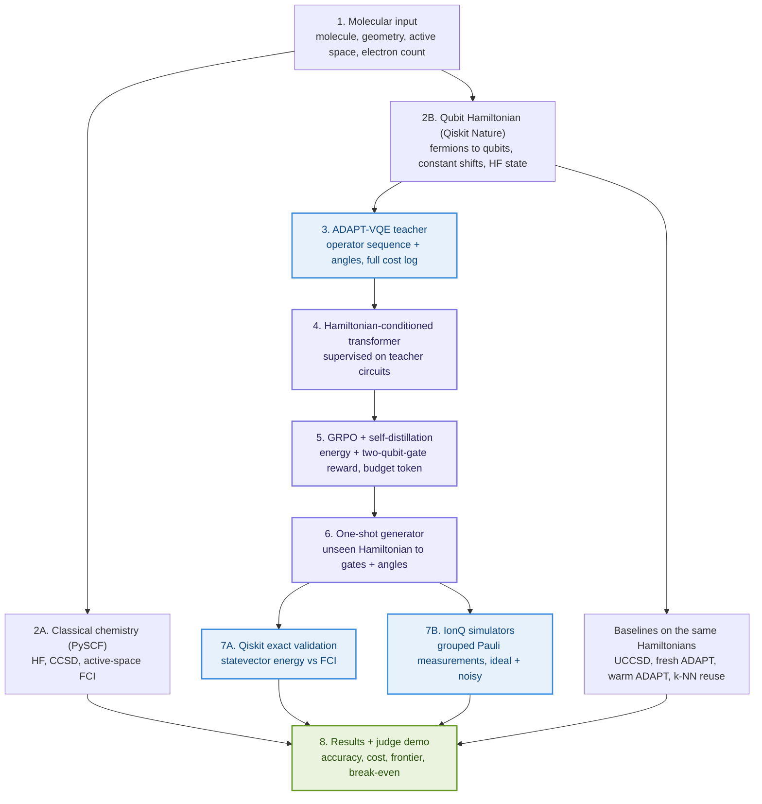

# GenQAI: Hardware-Aware Generative Quantum Circuit Synthesis

Full implementation plan · Qollab × IonQ Global Quantum Hackathon · Oct 9–11, 2026

Revision 2, Oct 10, 2026 · Udaya Vijay Anand · team of 3, each running multiple coding agents

Supersedes the "miniature" plan of revision 1. Changes: full ADAPT-GQE architecture (Hamiltonian-conditioned transformer, operators + angles, SFT → GRPO → self-distillation) instead of an operator-only GRU; CCSD and FCI added as classical baselines, Hartree-Fock demoted; warm-started ADAPT and nearest-neighbour reuse added as the baselines that matter; resource-budgeted generation as the differentiator; amortised break-even accounting instead of the zero-gradient ratio; IonQ execution treated as a required measurement experiment; dependency pins and gate-count definitions corrected; prior-art statements corrected (the original paper does report gate counts and energy errors).

## 0. Live status tracker (update this first, every time)

This table is the source of truth for who is doing what. Before starting a task: set yourself as owner, set status to 🟨, and commit and push that one-line change straight away (`git commit -m "tracker: claim C1"`), so nobody else picks it up. When you finish, set ✅ and put the commit or branch in Where. If a task is 🟨 with someone else's name, don't start it; ask them or pick another.

Status: ⬜ open · 🟨 in progress (claimed) · ✅ done, merged to main · 🔀 done on a branch, awaiting merge · ⛔ blocked (say on what)

Branches: one per task or lane, named `feat/<short-name>`. Only merge to main after `pytest -q` passes and the end-to-end pipeline still runs. Never force-push main. Secrets (`IONQ_API_KEY`) go in a local `.env` (gitignored), never in commits.

### Phase 2: molecular workbench (Oct 10 night; contracts in `docs/workbench_contracts.md`)

| ID | Task | Owner | Status | Where | Notes |
| --- | --- | --- | --- | --- | --- |
| W-A | Arbitrary molecules: SMILES (RDKit ETKDGv3, seeded), XYZ, atoms, presets; charge/multiplicity/basis/active space/mapping; open shell; capability report; generic Hamiltonian | Udaya (agent) | ✅ | main `genqai/molecule.py` | SMILES (ETKDGv3, seeded), XYZ, atoms, presets; open shell (ROHF); capability report; presets byte-identical. HeH⁺, H₂O (SMILES), OH• FCI = PySCF CASCI to 1e-8 |
| W-B | Model registry + routing (paths A/B/C/D) + unified generation API; default method chosen on VAL metrics | Udaya (agent) | ✅ | main `genqai/registry.py`, `genqai/generate.py`, `models/registry.json` | 21 model cards; default = best VAL (KRR on every system); paths A/B/C/D; gauge check on rotated H₄: 80 coefficient sign flips absorbed, energies equal to 1e-12 mHa |
| W-C | Circuit grading engine (validity, energy, resources, noise), two-stage ranking + Pareto, optimization (refine, prune, transpile, budget model); hardware-aware Pareto study vs KRR prefixes | Udaya (agent) | ✅ | main `genqai/grading.py`, `genqai/optimize.py`, `results/hw_opt.md`, fig9 | Two-stage grading (validity incl. below-FCI flag, then Pareto among circuits that meet the target). Prune+refine: H₄ 923 → ~600–670 CX, LiH-6q 298 → 162 at 100% < 1.6 mHa, but costs 250–2,900 energy evals per geometry (≥ fresh ADAPT): a different cost class, reported as such |
| W-D | Backend registry, generalized packed single-circuit measurement, analytic measurement tests, execution records with provenance | Udaya (agent) | ✅ | main `genqai/backends.py`, `genqai/execution.py` | Packed = grouped = statevector to 1e-12 on analytic Hamiltonians; stderr coverage 65–70% at 1σ; width refusal before submit; live IonQ Forte 1 sim h2 r=0.8: +25.0 ± 6.4 mHa (job 01a12845-095c-73f9-b107-03d2aa0cef79) |
| W-E | Streamlit workbench, exports (Qiskit code, QASM, JSON, CSV), experiment store, job runner | Udaya (agent) | ✅ | main `app/workbench.py`, `genqai/{export,store,jobs}.py` | Browser-verified locally: preset + SMILES water → Hamiltonian → routing → generate → grade → execute (local_shots) → saved experiment + 7 exports |
| W-F | Integration, regression checks, README, figures, Qollab bundle, submission text, video script | Udaya | ✅ | main README, `docs/{custom_molecules,submission,video_script,workbench_guide}.md` | All feature branches merged (epa left separate by request). torch/OpenMP segfault fixed. Custom HeH⁺ on IonQ Forte 1 sim: +36.1 ± 11.0 mHa (job 01a12858-0690-7546-94e7-76cddf9f0e3f). Qollab draft updated and re-verified (F7) |

### P1 — must ship (without these there is no submission)

| ID | Task | Owner | Status | Where | Notes |
| --- | --- | --- | --- | --- | --- |
| A1 | Hamiltonians for h2 (2q), lih4 (4q), lih6 (6q), h4 (8q) with HF / CCSD / FCI, geometry splits | Udaya | ✅ | main `3f621dc` | `scripts/make_hamiltonians.py`; built from PySCF CASCI integrals; 207 geometries |
| A2 | Gate G1 chemistry: qubit-Hamiltonian sector ground state equals PySCF CASCI | Udaya | ✅ | main `tests/test_core.py` | Agrees to 1e-7 on all four systems |
| B1 | ADAPT-VQE teacher labels with per-step cost logging | Udaya | ✅ | main `scripts/make_teacher.py` | All 207 converged and under 1.6 mHa (grad_tol 1e-4) |
| B2 | Shared eval harness `genqai/evaluate.py` + baselines: UCCSD-VQE, fresh ADAPT, warm ADAPT, NN reuse, NN+refine | Udaya (agent) | ✅ | main `129743c` | `results/<system>/<method>.jsonl`. nn_refine and warm ADAPT hit 1.6 mHa on every test geometry with 10–30× fewer gradient evals than fresh ADAPT: this is the bar the model must beat |
| B3 | Cross-check our ADAPT against `qiskit_algorithms.AdaptVQE` on h2 / lih4 | Udaya (agent) | ✅ | main `tests/test_baselines.py` | Agree within 1e-5 Ha |
| B4 | Fair baselines + untouched test: sign-corrected NN reuse, non-ML angle regression on the canonical sequence, fresh held-out geometries never seen during tuning, all methods scored once | Udaya (agent) | ✅ | main `results_fresh/`, `scripts/report_fair.py` | **Verdict: on a fixed operator sequence, kernel-ridge angle regression matches or beats SFT one-shot.** h4 test_fresh: regression 100% < 1.6 mHa (max 0.59) vs SFT 65% (max 14.6). Orbital-sign gauge fixing is what rescues NN (h4 max 520 → 4.3). LiH extrapolation: linear interpolation in r beats both learned models. Headline must move to what regression cannot do: variable sequences / budget conditioning (D3) |
| C1 | Hamiltonian-conditioned transformer (operators + von Mises angle head), SFT, one-shot / refine / best-of-K | Udaya (agent) | ✅ | main `checkpoints/<system>/sft.pt` | One-shot, zero energy evals, test median < 0.2 mHa all systems; h4 86% < 1.6 mHa (max 10.9) vs nn_reuse 32% (max 389). Weak spot: LiH extrapolation (max 5–7 mHa). Needed orbital-sign gauge fixing + canonical relabelling (one op sequence per system). Test set was lightly used during tuning: see B4 |
| E1 | Grouped Pauli measurement, finite-shot energy with error bars, local ideal + noisy | Udaya (agent) | ✅ | main `genqai/measure.py` | Exact-probability reconstruction = exact energy to 1e-9. Groups: h2 2, lih4 25, lih6 48, h4 46 |
| E2 | Same experiment on IonQ simulator, ideal + noisy (forte-1 / aria-1), one job | Udaya (agent) | ✅ | main `scripts/run_ionq_demo.py` | Real jobs ran. h2 (4 CX): aria-1 21 ± 6 mHa, forte-1 28 ± 7 mHa. lih4 teacher (172 CX): ~460 mHa under noise, so shorter circuits matter. Results in `results/*/ionq_demo_*.json` |
| E3 | Qollab runtime probe: Qiskit version, can we pip install, is PyTorch there, job/shot limits, noise models | Udaya | ✅ | `docs/qollab_runtime_checklist.md` | Verified by running on Qollab. Pyodide 3.14; PySCF has gto/scf/ao2mo but **no fci/mcscf/cc** (worked around); IonQ gateway takes **single-circuit jobs only** (worked around by packing groups); noise-model IonQ sims are free |
| F1 | Integrate branches to main; one-command end-to-end run (data → teacher → SFT → generate → score → IonQ) | Udaya (agent) | ✅ | main `scripts/run_pipeline.py` | `--quick` (h2 + lih4) runs end to end in ~90 s; `--skip-train` uses committed checkpoints |
| F2 | Judge-facing Qollab notebook: pick unseen geometry → generated circuit → energy vs FCI/HF/CCSD/ADAPT → IonQ run | Udaya (agent) | ✅ | main `notebooks/genqai_demo.ipynb`, `scripts/demo.py` | Run All works; live PySCF for any geometry, live generation, fair baselines, live ADAPT costs, IonQ ideal + aria-1 + forte-1 for h2. Falls back to stored Hamiltonians / replay if PySCF / torch missing. Still needs the E3 check on Qollab itself |
| F7 | Qollab project bundle `qollab/`: `main.py` with a main() form, NumPy transformer inference (no torch), live PySCF Hamiltonian, one-job IonQ grouped measurement, exported weights ≤ 2 MB/file | Udaya | ✅ | Qollab draft: qollab.xyz/u/udsy/genqai-one-shot-quantum-chemis | Draft updated Oct 11 to the phase-2 bundle (commit a249f96) and re-verified on Qollab: built-in sim OK; **IonQ Forte 1 sim +16.75 ± 5.96 mHa** (job 01a1285e-639a-7445-8d01-aa0365bdc241). Earlier run +7.8 ± 5.8 (job 01a12826-…). Still a DRAFT: publishing = submitting, which needs the team OK |
| F3 | Figures 1 (energy curve + residuals), 2 (one-shot vs optimised), 3 (accuracy vs CNOTs), 5 (break-even), 6 (IonQ ideal vs noisy), regenerable from `results/` | Udaya (agent) | ✅ | main `figures/` | `python scripts/make_figures.py`; also writes `figures/summary.md` (README table) and `breakeven.json`. Generator methods appear automatically once their EvalRecords exist. Fig 4 waits on training logs |
| F4 | README, ATTRIBUTION.md (every reused component + licence), MIT licence | Udaya | ✅ | main `README.md`, `ATTRIBUTION.md`, `LICENSE` | Final write-up built on test_fresh numbers, including the negative results (KRR ≥ transformer; RL no gain; no one-shot extrapolation) |
| F5 | 150 s video recording a real run | open | ⬜ | | Human task |
| F6 | Qollab project page, submission before Oct 11 7 PM ET | open | ⬜ | | Human task |

### P2 — the research contribution (do after the P1 item it depends on)

| ID | Task | Owner | Status | Where | Notes |
| --- | --- | --- | --- | --- | --- |
| D1 | GRPO on SFT policy, energy reward, KL to SFT, replay cache, separately evaluated checkpoint | Udaya (agent) | ✅ | main `genqai/rl.py`, `scripts/train_grpo.py` | **Negative result:** energy-only GRPO does not improve held-out error on any system (h4 test_fresh 65% < 1.6 mHa, same as SFT). SFT stays the shipped model |
| D2 | Self-distillation round(s): SFT → SFT+GRPO → SFT+GRPO+distill, all scored on the frozen test set | Udaya (agent) | ✅ | main `scripts/distill_targets.py` | **Negative result:** replay improved 10/35 h4 train labels, but distillation made held-out error worse (h4 grid max 113 mHa) |
| D3 | Budget-conditioned GRPO; energy-vs-CNOT frontier from one model vs ADAPT per budget | Udaya (agent) | ✅ | main `figures/fig7_budget_frontier.png`, `scripts/budget_frontier.py` | GRPO is what makes budget conditioning work (budget-SFT ignored small budgets and blew up at large ones; after GRPO, CX tracks the budget). But at matched CX, KRR on a fixed prefix beats it (h4 ~736 CX: 95%/80% vs 82%/55% < 1.6 mHa). Cheapest honest hardware win: 14-op prefix + KRR, about 20% fewer CX than SFT at 95% (grid) / 80% (fresh) |
| D4 | Break-even analysis (wall-clock and quantum-resource accounting), vs fresh and warm ADAPT; Figure 5 | Udaya (agent) | ✅ | main `figures/fig5_breakeven.png`, `figures/breakeven.json` | Evaluation-count and wall-clock versions, vs fresh ADAPT, warm ADAPT, nn_refine and the generators |
| D5 | Figure 4: training evolution (held-out error and CNOTs per checkpoint for SFT / GRPO / distill) | Udaya (agent) | ✅ | main `figures/fig4_training.png` | SFT / GRPO / distill curves |
| D6 | Ablations: Hamiltonian vs geometry-only conditioning; NN vs transformer; energy-only vs resource-aware reward | Udaya (agent) | ✅ | main `results/ablations.md` | On h4 test_fresh: canonical labels and Hamiltonian conditioning carry the accuracy; gauge fixing matters (KRR 100% → 80% without it); the transformer adds no accuracy over KRR |
| D7 | IonQ native 2-qubit gate counts (MS/ZZ) for generated vs ADAPT circuits | open | ⬜ | | Never relabel CX as native |

### P3 — upside if time remains

| ID | Task | Owner | Status | Where | Notes |
| --- | --- | --- | --- | --- | --- |
| X1 | Figure 7: learning curve (held-out error vs 10 / 20 / all training geometries) | Udaya (agent) | ✅ | main `figures/fig8_learning_curve.png` | KRR beats the transformer at every N; h4 KRR reaches 95% < 1.6 mHa with 20 train geometries, while the transformer gets 65% with all 35 |
| X2 | Several teacher runs per geometry (seeds / perturbed init) as extra labels | open | ⬜ | | Same split, not new independent examples |
| X3 | Qubit-excitation or CEO pool as a controlled comparison teacher | open | ⬜ | | Never mixed into the primary teacher |
| X4 | H₄ or LiH-6q on IonQ noisy simulator | open | ⬜ | | Check group count and shot budget first |
| X5 | Tokenised-angle reference model (paper-faithful variant) | open | ⬜ | | |

## 1. What we are building

A complete, small-scale reproduction of the Quantinuum–NVIDIA–Pfizer ADAPT-GQE architecture, plus one tested extension: a generator conditioned on a two-qubit-gate budget, so that it emits the cheapest circuit that meets an accuracy target for a new molecular geometry, in one shot, with no ADAPT search and no per-geometry VQE.

The pipeline: molecular Hamiltonian → ADAPT-VQE teacher → Hamiltonian-conditioned transformer that emits operators *and* angles → GRPO with an energy-and-resource reward → self-distillation → one-shot circuit for an unseen geometry → exact validation in Qiskit → finite-shot measurement experiment on IonQ's ideal and noisy simulators → benchmark against classical chemistry and against every quantum baseline that a careful reviewer would ask for.

We reproduce the architecture, not the original's scale. The original used ~13,000–15,700 circuits per dataset, 325M- and 12B-parameter models, eight H100s for one 16-qubit benchmark, and Helios-1 hardware. We use 2–8 qubit active spaces, 50–300 teacher circuits, a model in the low millions of parameters, CPUs or one GPU, and IonQ's simulators.

### The one-paragraph claim, written as a hypothesis

For LiH and an H₄ chain in explicitly documented active spaces, a Hamiltonian-conditioned generator trained on ADAPT-VQE circuits produces complete circuits for held-out geometries whose energies lie within 1.6 mHa of active-space FCI, at lower total quantum resource cost (energy evaluations, two-qubit gates, estimated shots) than fresh ADAPT-VQE and than geometry-warm-started ADAPT at matched accuracy, with a measured training-cost break-even point; and a budget-conditioned variant covers the energy-versus-gate-count frontier without rerunning ADAPT per budget. Every one of those clauses is a measurement to be made, not a result to be assumed.

### What we do not claim

- Quantum advantage over classical chemistry. At 2–8 qubits, FCI is instant and CCSD is exact for the 2-electron LiH active spaces. The classical comparison exists to keep us honest, not to be beaten. Only H₄ (4 electrons, stretched) is a regime where CCSD can visibly fail, and even there FCI is trivial.
- That the generator is quantum. It is a classical model trained on quantum-simulation data, as in the original.
- Wall-clock speedups. The simulator is a classical computer. The cost model is quantum resources (evaluations, gates, shots) and amortised training cost, reported separately from CPU time.
- Hardware accuracy. The original's hardware energy error was ~200 mHa vs 1.15 mHa ideal. Our noisy-simulator result will miss chemical accuracy; we report it with error bars and say so.

## 2. Background and prior art

**ADAPT-VQE** (Grimsley et al. 2019). Grow the ansatz greedily: compute the gradient ⟨ψ|[H, A_k]|ψ⟩ for every operator in a pool, append the largest, re-optimise all parameters, repeat to convergence. Compact and accurate; the search costs pool-size gradient evaluations and a full re-optimisation per step.

**ADAPT-GQE / GenQAI** (Quantinuum, NVIDIA, Pfizer; [arXiv 2607.22468](https://arxiv.org/abs/2607.22468), July 2026). GPU-accelerated ADAPT-VQE (CUDA-Q) generates circuits for thousands of imipramine conformers at 12–16 active-space qubits. A Hamiltonian-conditioned transformer (coefficients canonically ordered and projected by a learned encoder; fine-tuned Gemma 3 / Nemotron, plus a smaller model trained from scratch) is trained to emit the full circuit, operators and tokenised angles, in one forward pass. GRPO with an energy reward and self-distillation improve on the supervised model. Best-of-16 sampling at test time. Reported: 3–4 orders of magnitude faster circuit generation than ADAPT; two-qubit gate counts (e.g. 1,440 canonical → 244 hardware-optimised); energy errors against CASCI/CCSD (1.15 mHa ideal, 82 mHa emulator, 200 mHa on Helios-1); dataset-size effects. Post-training improved accuracy but sometimes lengthened circuits. Correction to revision 1: the paper does publish depth and error numbers; the press coverage omitted them.

**Flow-VQE** ([npj Quantum Information 2025](https://www.nature.com/articles/s41534-025-01159-x)). Learned generative warm-starts of VQE parameters across molecular geometries, including H₄; reports up to two orders of magnitude fewer circuit evaluations than HF-initialised VQE. Establishes that learned geometry-to-parameter transfer is prior art; we cite it and compare against the same idea via our warm-started baselines.

**Open-source starting points.** [Conditional_GQE](https://github.com/Quantum-Buddies/Conditional_GQE) (reported MIT; conditional transformer, chemistry encoder, GRPO/DAPO, energy caching; built on CUDA-Q/qBraid, not Qiskit), [gqe-for-qsci](https://github.com/moken20/gqe-for-qsci) (GRPO + replay for circuit generation), [CEO-ADAPT-VQE](https://github.com/mafaldaramoa/ceo-adapt-vqe) (pools, resource accounting), [PennyLane GQE demo](https://pennylane.ai/demos/gqe_training), [nanoGPT](https://github.com/karpathy/nanoGPT). We reuse ideas and small tested components, keep copyright notices, verify each licence before copying a line, and disclose every reuse on the project page; judging is on what we add.

Where our contribution sits:

| Component | Status |
| --- | --- |
| AI-generated molecular ansätze; learning from ADAPT; geometry generalisation; energy + gate reporting | Established by ADAPT-GQE, GQE, Flow-VQE |
| Full architecture reproduced in open Qiskit code at 2–8 qubits, with every baseline a reviewer asks for | Engineering contribution, useful to the community |
| Measured amortised cost and break-even against geometry-aware ADAPT and nearest-neighbour reuse | Not established conclusively by prior work |
| Budget-conditioned one-shot generation covering the energy–gate frontier | Our proposed extension; novelty if it beats unconditioned GRPO and per-budget ADAPT |

## 3. System design



Purple: the learned components that replace ADAPT's search. Blue: quantum simulation. Green: outputs. Baselines run on the same Hamiltonians and feed the same results table.

### Integration contracts (agree before any parallel work)

Agents and people work in parallel only if these four records are frozen first. A mismatch in operator indices or qubit ordering silently invalidates everything downstream.

1. **Hamiltonian record** (`data/hamiltonians/<molecule>/<geometry_id>.json`): `geometry_id`, `molecule`, `coordinates_angstrom`, `basis`, `active_electrons`, `active_orbitals`, `mapping` (parity | jordan_wigner), `two_qubit_reduction`, `num_qubits`, `pauli_terms` [{pauli, coeff}] in canonical order, `energy_shift` (nuclear + inactive core), `hf_bitstring`, `e_hf`, `e_ccsd`, `e_fci_active`, `software_versions`.
2. **Operator pool** (`data/pools/<molecule>_<active_space>.json`): deterministic `operator_id` → generator definition (fermionic single/double indices, mapped Pauli strings, anti-Hermitian convention, gradient sign), gate synthesis recipe, two-qubit gate count per operator. One pool per (molecule, active space). Fermionic singles and doubles are the primary pool; qubit-excitation pools are a controlled comparison, never mixed silently.
3. **Circuit record**: `hamiltonian_id`, ordered list of `(operator_id, angle)`, `valid` flag, `source` (adapt | knn | sft | grpo | grpo_distilled | budget_grpo), `budget_token` if any, `generation_cost` (forward passes, candidates scored).
4. **Evaluation record** (`data/metrics.csv`): `method`, `hamiltonian_id`, `split`, `seed`, `energy`, `delta_mHa`, `converged`, `pool_gradient_evals`, `energy_evals`, `estimator_calls`, `circuit_executions`, `estimated_shots`, `cnot_count_generic`, `two_qubit_native_ionq`, `depth`, `forward_passes`, `wall_seconds`.

## 4. Workstream A: chemistry and teacher data

### A1. Molecules and active spaces

| System | Active space, mapping | Qubits | Geometry parameters | Purpose |
| --- | --- | --- | --- | --- |
| H₂ | CAS(2e,2o), parity + 2-qubit reduction | 2 | bond length, 12–20 points | End-to-end correctness, measurement-grouping test |
| LiH | CAS(2e,3o), frozen 1s core, parity reduction | 4 | bond length 1.0–3.5 Å, 50–80 points | Fast primary demonstration |
| LiH | CAS(2e,4o), frozen core, parity reduction | 6 | bond length, 30–60 points | Harder primary benchmark |
| H₄ linear chain | CAS(4e,4o), Jordan–Wigner | 8 | spacings (a, b, a): x = (0, a, a+b, 2a+b), 36–64 grid points | Two-parameter generalisation; the only system where CCSD can visibly fail |

Active space, mapping and reduction are recorded in every Hamiltonian record. Exact diagonalisation is done in the correct particle-number and spin sector, with all constant shifts restored, and must agree with PySCF CASCI to 1e-8 Ha before anything else is built (gate A3).

### A2. Hamiltonians

PySCF (STO-3G) → integrals → Qiskit Nature 0.8.x `ActiveSpaceTransformer`, `ParityMapper` / `JordanWignerMapper` → `SparsePauliOp` → canonical ordering → JSON. PySCF and Qiskit Nature run only in the local build environment; Qollab reads JSON.

### A3. Classical references

For every geometry: E_HF, E_CCSD, E_FCI (active-space CASCI). FCI is the energy-error reference. CCSD is the classical comparison shown on every energy figure. HF is the single-determinant illustration. Never compare a total molecular energy from one method to an active-space electronic energy without restoring constants.

### A4. ADAPT-VQE teacher

Start from `qiskit_algorithms.AdaptVQE` (documented working stack: Qiskit 2.4–2.5, Nature 0.8.0, Algorithms 0.4.0) wrapped with full logging. Per step record: operator chosen, optimised angle, energy after re-optimisation, pool gradient evaluations, energy evaluations in the optimiser, iterations, cumulative generic CNOTs and depth. Stop on gradient norm < 1e-3 or |ΔE| < 1.6 mHa; record `converged` separately from "hit max iterations". Never relabel a max-iteration stop as chemically accurate.

Two teacher variants, both kept: **fresh ADAPT** (from HF, every geometry) and **warm-started ADAPT** (initialised from the nearest solved geometry's circuit and angles). The warm variant is also a baseline.

### A5. Dataset targets and splits

| Dataset | Unique geometries | Teacher runs | Priority |
| --- | --- | --- | --- |
| H₂ smoke | 12–20 | 12–20 | Mandatory |
| LiH 4q | 50–80 | 100–300 (multiple optimiser seeds per geometry) | Mandatory |
| LiH 6q | 30–60 | 60–180 | High |
| H₄ 8q | 36–64 | 36–128 | Stretch |

Split by unique geometry before labelling; all seeds of a geometry stay in one split. Three test conditions, reported separately: random interpolation holdout, one or two **contiguous** held-out intervals, and extrapolation beyond the training range. Test energies never tune anything.

### A6. Speed

Cache everything by (physical configuration, software version): Hamiltonians, mapped operators, circuit energies, labels. Statevector via Qiskit; Qiskit Aer or Qulacs if available; GPU/CUDA-Q only if a compatible machine exists. Warm-starting ADAPT from neighbours is also the fastest way to generate labels; keep fresh-ADAPT labels for a subset so the comparison is honest.

## 5. Workstream B: Hamiltonian-conditioned generator

### B1. Interface

Input: canonically ordered Hamiltonian coefficient vector for a fixed (molecule, active space, pool), plus an optional budget token (two-qubit gate budget, accuracy target). Output: sequence of (operator_id, angle) pairs and an end token. One model per active space, as in the original.

### B2. Hamiltonian encoder

Fixed-order coefficient vector → zero-pad + mask → normalise with training-split statistics → linear projection → LayerNorm + SiLU → 2 residual MLP blocks → embedding that conditions every decoder step (prefix token or cross-attention). Ablation: geometry-only conditioning (bond length) vs Hamiltonian conditioning.

### B3. Decoder

Decoder-only causal transformer, starting configuration: 4 layers, d=128, 4 heads, FFN 512, dropout 0.1, RoPE or learned positions, max 16 operators (expandable to 32), AdamW, warmup + cosine. Low millions of parameters. nanoGPT or a minimal Hugging Face model as the base; Conditional_GQE components where they transplant cleanly.

### B4. Angles: structured continuous head (primary) with tokenised fallback

Primary: at each step a categorical head predicts the operator and a continuous head predicts the angle (mixture density or von Mises, periodic where the gate is periodic). Loss L = L_operator + λ_θ L_angle + λ_stop L_EOS. Fallback that matches the paper: digit-tokenised angles in the same causal stream. Keep both in the repo; the primary is what we evaluate.

### B5. Supervised training

Train on complete teacher sequences (operators and angles). Track: operator accuracy (diagnostic only), angle error, valid-circuit rate, **energy of the generated circuit before any refinement**, held-out energy by split, training and inference time. Energy matters; sequence agreement does not, since different circuits can prepare equally good states.

### B6. Inference modes (all three always available)

| Mode | What runs | Cost counted |
| --- | --- | --- |
| One-shot | Generate operators + angles, evaluate once | 1 forward pass + 1 energy evaluation |
| Generate + refine | Generate, then optimise angles only | + optimiser energy evaluations |
| Best-of-K | Generate K candidates, score all, keep lowest | K forward passes + K energy evaluations (the original used K=16; it is not free) |

One-shot is the headline claim. If best-of-K or refinement is needed to reach 1.6 mHa, the figures show the extra cost.

## 6. Workstream C: reinforcement learning and self-distillation

### C1. GRPO

Policy initialised from the SFT checkpoint. Per training Hamiltonian: sample a group of G candidates (G = 4–8, temperature 0.7–1.0), validate and decode, evaluate energy on the cached statevector, compute reward, normalise advantages within the group A_i = (R_i − mean R) / (σ_R + ε), clipped policy update with KL penalty to the SFT reference, write candidates and energies to a replay store. Focused PyTorch implementation; Hugging Face TRL `GRPOTrainer` only if the custom continuous-angle model fits its interface. 1–3 rounds. All reference energies precomputed; no FCI or ADAPT inside the RL loop.

### C2. Reward

R = −(E_circuit − E_FCI) / (E_HF − E_FCI + ε) − λ · G_2q / G_budget − μ · D / D_budget − R_invalid

Normalised and capped. FCI in the reward is privileged supervision at toy scale: disclosed as such, never an input to the test-time generator, and a secondary reference-free reward (improvement over HF or over the teacher candidate) is also run.

### C3. The extension: budget-conditioned generation

Prepend a budget token (requested two-qubit gates, requested accuracy) to the condition. Train GRPO with the matching G_budget in the reward. At test time, sweep budgets for one Hamiltonian and obtain a family of circuits. Hypothesis: a budget-conditioned generator covers the energy-versus-gate frontier in one shot per budget, without rerunning ADAPT or an unconditioned model per budget, and with a better frontier than depth-penalised GRPO alone. Compared against: unconditioned SFT, unconditioned GRPO, ADAPT truncated at each budget.

### C4. Self-distillation

After each GRPO round: keep the best valid circuits per training Hamiltonian from replay, fine-tune the transformer on them, one short supervised pass. Evaluate three checkpoints separately: SFT, SFT+GRPO, SFT+GRPO+distillation. Checkpoint selection by held-out validation energy and gate cost, never by training reward.

### C5. Protect the working baseline

Once SFT generates valid circuits for unseen geometries and the evaluation harness scores them, freeze that checkpoint. GRPO improves the submission or is reported as a negative result; it never replaces a working model with a broken one.

## 7. Workstream D: benchmarking

### D1. Methods in the matrix

| Method | Why it is there |
| --- | --- |
| Hartree–Fock | Single-determinant reference; shows the correlation energy at stake |
| CCSD | Strong classical reference; exact for 2e active spaces, so LiH energy figures will show it on top of FCI |
| Active-space FCI | The energy-error reference |
| UCCSD-VQE | Standard fixed-ansatz quantum baseline |
| Fresh ADAPT-VQE | The method being replaced |
| Warm-started ADAPT | The adaptive baseline a practitioner would actually use |
| Nearest-neighbour circuit reuse | Non-ML amortisation baseline (copy nearest geometry's circuit and angles, evaluate once) |
| Nearest-neighbour + angle refinement | Strong baseline on smooth 1-D sweeps |
| SFT generator (one-shot, refine, best-of-K) | What imitation achieves |
| GRPO generator | Incremental value of RL |
| GRPO + distillation | Full architecture |
| Budget-conditioned GRPO | Our extension |

Full matrix on the offline simulator; a subset on IonQ.

### D2. Energy metric

ΔE_mHa = 1000 (E_method − E_FCI). Thresholds: 1.6 mHa (strict, "within chemical accuracy of active-space FCI"), 5 and 10 mHa (secondary, to show progress where one-shot is not yet precise). Report per split: fraction under each threshold, median, worst case, per-geometry points.

### D3. Cost metrics (all recorded, never collapsed into one speedup number)

Pool gradient evaluations · energy evaluations · estimator calls (with batching noted) · distinct circuit executions · estimated measurement shots (from Pauli grouping and a stated variance target) · generic CNOT count · IonQ-native two-qubit (ZZ/MS) gate count after compilation · depth · model forward passes · classical wall-clock · training cost (teacher labels + model fitting). One `StatevectorEstimator` call is not one physical measurement; the shot estimate is computed separately. Convergence failures within budget are logged per method.

### D4. Break-even

C_GenQAI(M) = C_train + M · C_inference; C_ADAPT(M) = M · C_ADAPT; M_break-even = C_train / (C_ADAPT − C_inference) when positive. Computed under two accountings (classical wall-clock; estimated quantum resources), against both fresh and warm-started ADAPT, with C_inference including best-of-K and refinement when used. If the curves do not cross in a sensible range, the figure says so.

### D5. Ablations (same frozen test set)

Geometry-only vs Hamiltonian conditioning · k-NN vs transformer · SFT vs SFT+GRPO · GRPO vs GRPO+distillation · energy-only vs resource-aware reward · one-shot vs refine vs best-of-K · budget-conditioned vs unconditioned. Priority if compute is short: SFT vs GRPO, k-NN vs transformer, energy-only vs resource-aware.

## 8. Workstream E: IonQ execution (required, not decorative)

The published hackathon material says projects run on Qollab's free simulators including IonQ's; revision 1's reading that the IonQ job "does not affect scoring" is an inference from a FAQ line, not a confirmed rule. We treat a working IonQ measurement experiment as a hard requirement.

### E1. Energy needs measurement circuits, not one circuit

E = Σ_j h_j ⟨P_j⟩ + E_shift with X, Y, Z Paulis. Workflow: generated circuit → `SparsePauliOp.group_commuting(qubit_wise=True)` → one measurement circuit per group with basis rotations → run → bitstrings → Pauli expectations → energy with uncertainty. H₂ first (few groups), then the LiH 4q case. If Qollab allows one IonQ job per run, submit the groups as one multi-circuit job (IonQ allows up to 5,000 circuits per job); verify in the live workspace.

### E2. Three results for the same circuit

Exact statevector (ideal accuracy) · IonQ ideal simulator (execution compatibility; note it returns probabilities, so client-side sampling is labelled as such) · IonQ noisy simulator, forte-1 model, finite shots with error bars (noise sensitivity). Noisy simulation is not hardware validation and is labelled that way.

### E3. Gate accounting

Report generic-basis CNOT counts and compiled IonQ-native two-qubit counts as two columns. Never call the native number "CNOTs".

### E4. Verify in the live Qollab workspace before anything depends on it

Qiskit version · whether `pip install` is permitted · PyTorch availability · circuits per job · shot budget · available noise models · whether a judge's fresh Run completes from cached data in under 10 minutes.

## 9. Workstream F: judge-facing demo

Separate the offline research pipeline from a small, transparent Qollab notebook. The judge selects molecule, geometry and method (ADAPT, k-NN, SFT, GRPO, budget-GRPO at a chosen budget) and sees: the generated circuit with operators and angles, its energy against FCI with the threshold, its cost row, and whether the target was met; plus the IonQ cell. Model inference runs live from a frozen checkpoint if PyTorch is present; otherwise the notebook loads stored generated circuits and says so plainly — a replay is labelled a replay, never presented as live generalisation. Full weights and training notebooks ship in the repo regardless.

## 10. Figures

1. **Ground-state energy vs geometry** — LiH (and H₄ cut): FCI, HF, CCSD, ADAPT, GenQAI one-shot on held-out points; residual panel in mHa with the 1.6 mHa band. On LiH, CCSD will sit on FCI; that is shown, not hidden.
2. **One-shot vs optimised accuracy** — per-geometry points / box plots for fresh ADAPT, warm ADAPT, k-NN, k-NN+refine, SFT one-shot, GRPO one-shot, generate+refine, best-of-K; caption states candidates and evaluations used by each.
3. **Accuracy vs quantum resource** — ΔE vs native two-qubit gates (and vs estimated shots), one point per method, Pareto front drawn; budget-conditioned circuits as a connected sweep.
4. **Training evolution** — held-out ΔE and gate count across checkpoints: SFT → GRPO → distilled. A model that improves training reward but worsens held-out error is reported as such.
5. **Amortised cost and break-even** — cumulative cost vs number of new geometries for fresh ADAPT, warm ADAPT, GenQAI including training; two accountings.
6. **IonQ ideal vs noisy** — one geometry: FCI, exact circuit energy, IonQ ideal, IonQ noisy finite-shot with CI.
7. *(optional)* **Learning efficiency** — held-out ΔE vs number of labelled training geometries (10, 20, 40, all).

Hygiene: every figure regenerated by one script from `metrics.csv`; seeds in filenames; error bars from ≥5 seeds; geometry-level outcomes shown individually where n is small; one colour per method across all figures; chemical-accuracy line on every energy plot.

## 11. Stack and environments

| Layer | Local build | Qollab runtime (what judges run) |
| --- | --- | --- |
| Qiskit | 2.5.x, pinned < 3.0 | same |
| Chemistry | PySCF, qiskit-nature 0.8.0 (Qiskit 2-compatible; 0.7.x is not) | none; JSON Hamiltonians |
| Algorithms | qiskit-algorithms 0.4.0 (`AdaptVQE`, `VQE`), vendored fallbacks | vendored evaluation only |
| Simulation | `StatevectorEstimator`; Aer/Qulacs optional | `StatevectorEstimator`; `qiskit-ionq` 1.1.x for IonQ |
| ML | PyTorch; nanoGPT-style decoder; optional TRL | PyTorch if present, else stored circuits |
| Plots | matplotlib | matplotlib |

Repository layout:

```
data/hamiltonians/<molecule>/<geometry_id>.json   data/pools/   data/teacher/<molecule>.jsonl
data/splits/   data/metrics.csv   checkpoints/{sft,grpo,grpo_distilled,budget_grpo}.pt
src/chem/  (pyscf + nature, local only)   src/hamiltonian.py   src/pool.py
src/adapt.py   src/baselines.py   src/model/{encoder,decoder,heads}.py
src/train/{sft,grpo,distill}.py   src/eval/{energy,cost,shots,ionq}.py   src/plots.py
notebooks/00_h2_smoke   01_hamiltonians   02_teacher   03_sft   04_grpo   05_benchmark   06_ionq   07_demo
README.md   LICENSE (MIT)   ATTRIBUTION.md   figures/
```

## 12. Parallel execution: 3 people, many agents

Parallelise by the four integration contracts, not by directory. Chemistry and teacher labels are upstream of everything; the first valid H₂ record unblocks every other lane the same hour.

| Lane | Human owner | Agents run | Must deliver |
| --- | --- | --- | --- |
| A — Chemistry + Hamiltonians | Person 1 | PySCF/Nature agent; validation agent (FCI sector + shift checks) | Hamiltonian records for H₂, LiH 4q/6q, H₄; HF/CCSD/FCI |
| B — Teacher + quantum baselines | Person 1 | ADAPT logging agent; UCCSD/k-NN/warm-ADAPT agent; cost-accounting agent | Teacher circuits, baselines, `metrics.csv` rows |
| C — Generator (SFT) | Person 2 | encoder/decoder agent; angle-head agent; training-loop agent | SFT checkpoint generating valid circuits for held-out geometries |
| D — RL + extension | Person 2 | GRPO agent; reward/replay agent; budget-conditioning agent | GRPO, distilled, budget checkpoints with separate evaluations |
| E — IonQ + Qollab | Person 3 | measurement-grouping agent; Qollab runtime probe agent | Working grouped-measurement experiment, ideal + noisy, in the Qollab runtime |
| F — Figures, page, video | Person 3 | plotting agent; docs agent | Six regenerable figures, README, ATTRIBUTION, page, 150 s video |

```mermaid
gantt
    title Execution blocks, relative effort, gates as diamonds
    dateFormat X
    axisFormat %s

    section A Chemistry
    H2 + LiH records, FCI agreement       :crit, a1, 0, 10
    LiH 6q + H4 records                   :a2, 10, 35

    section B Teacher + baselines
    ADAPT logging, UCCSD, k-NN            :crit, b1, 10, 35
    Warm ADAPT, cost rows, stats          :b2, 35, 70

    section C Generator SFT
    Schema, encoder, decoder, heads       :c1, 0, 20
    Train SFT on first labels             :crit, c2, 20, 45

    section D RL + extension
    GRPO + replay                         :d1, 45, 70
    Budget-conditioned + distillation     :d2, 70, 90

    section E IonQ + Qollab
    Runtime probe, grouping on H2         :e1, 0, 20
    LiH measurement experiment            :e2, 70, 90

    section F Figures + page
    Harness + first figures               :f1, 35, 70
    Final figures, video, fresh-run test  :crit, f2, 90, 100

    section Gates
    G1 H2 agrees with PySCF, Qollab runs  :milestone, g1, 10, 0
    G2 SFT circuit for unseen geometry    :milestone, g2, 45, 0
    G3 Full baseline matrix in CSV        :milestone, g3, 70, 0
    G4 IonQ experiment + figures real     :milestone, g4, 90, 0
```



### Gates

- [ ] G1 — H₂: Hamiltonian record, PySCF CASCI and Qiskit diagonalisation agree; a measured 2-qubit circuit energy matches; the notebook runs in the Qollab runtime; runtime facts (E4) recorded.
- [ ] G2 — LiH 4q: teacher produces valid operator-angle sequences; SFT generates a valid circuit for an unseen geometry; every generated circuit is independently scored by Qiskit.
- [ ] G3 — Full benchmark matrix (HF, CCSD, FCI, UCCSD, fresh ADAPT, warm ADAPT, k-NN, k-NN+refine, SFT ×3 modes) in `metrics.csv` for LiH 4q; GRPO produces a separately evaluated checkpoint.
- [ ] G4 — IonQ grouped-measurement experiment returns ideal and noisy energies with error bars; all six figures regenerate from logged results.
- [ ] Ship — Qollab project runs in a fresh session; video public; MIT licence; ATTRIBUTION.md lists every reused component and its licence; project page claims match measured evidence.

Rule: once G2 passes, that SFT checkpoint and its evaluation are frozen and shippable. Everything after is upside.

## 13. Risks and fallbacks

| Risk | Signal | Fallback (and what it costs the claim) |
| --- | --- | --- |
| Qollab runtime lacks PySCF / Nature / PyTorch | G1 probe | JSON Hamiltonians, vendored evaluation, stored circuits for the demo; demo labelled replay, weights shipped for offline reproduction |
| `AdaptVQE` API friction on Qiskit 2.5 | G1/G2 | Vendored ~150-line ADAPT over the same pool, validated against the library on H₂ |
| ADAPT does not reach 1.6 mHa on stretched LiH in budget | B lane | Report convergence status honestly; depth-matched comparison as a separate experiment, not a substitute for the accuracy criterion |
| 40–60 geometries too few for the transformer; k-NN wins | G2/G3 | Report it; the contribution becomes the benchmark of reuse vs learning plus the budget-conditioned experiment; add seeds-per-geometry labels and the learning-efficiency figure |
| GRPO destabilises or overfits training reward | D lane | KL to SFT, reward capping, checkpoint by held-out energy; SFT remains the shipped model; negative result reported |
| One-shot misses 1.6 mHa; refine or best-of-K needed | G3 | Show the extra cost in Figures 2 and 5; one-shot reported at 5/10 mHa thresholds |
| IonQ job limits block grouped measurement | E lane | Smaller Hamiltonian (H₂) for the IonQ experiment; LiH on the local simulator only; limits documented |
| Reused code licence unclear | any | Treat as reference only; reimplement; ATTRIBUTION.md |
| Novelty judged low | judging | Lead with the measured break-even, the budget-conditioned frontier, and the complete open Qiskit reproduction with every baseline |
| Scope creep | any lane | H₄ and budget-conditioning gated behind G3; cross-molecule transfer and >8 qubits out of scope |

## 14. What we can credibly claim, by level reached

| Level | Result | Claim |
| --- | --- | --- |
| 1 | Pipeline executes end to end | Open, reproducible ADAPT-GQE-style architecture in Qiskit at 2–8 qubits |
| 2 | Generated circuits reach useful accuracy on held-out geometries | Generative AI constructs valid ground-state circuits for unseen molecular geometries |
| 3 | Lower total resource cost than fresh and warm ADAPT at matched accuracy, with measured break-even | A measured improvement in the circuit-synthesis workflow |
| 4 | Budget-conditioned generation improves the accuracy–resource frontier over unconditioned GRPO | Our extension improves the trade-off |

End-to-end quantum advantage over classical chemistry is not claimable at this scale and is not claimed.

## 15. Submission artefacts and page

Artefacts: Qollab runnable experiment · source repository · frozen checkpoints (SFT, GRPO, distilled, budget) · dataset (Hamiltonians, teacher circuits, splits, provenance) · `metrics.csv` · evaluation notebooks (Run All regenerates figures) · README (architecture, run, environments, limitations) · results page (every claim linked to a figure) · 150 s video · ATTRIBUTION.md (original research, reused code, licences, starter-code disclosure).

Page order: one sentence (AI generates the circuit instead of running ADAPT's search per geometry) with the measured accuracy and cost on screen one → why ADAPT is expensive and the pipeline, highlighting Hamiltonian conditioning and GRPO → Figures 1 and 2 → Figure 3 frontier and whether budget-conditioning helped → Figure 6 IonQ with finite-shot uncertainty → reproduction, licensing, prior work, limitations, roadmap. No drug-discovery grandstanding; measurements first.

Video (150 s): 0–20 problem and energy curve · 20–50 pipeline · 50–90 live demo on an unseen geometry (real execution on screen) · 90–125 evidence (Figures 2, 3, 4), measured numbers only · 125–150 IonQ result, limits, why reusable synthesis matters at scale.

## 16. After the hackathon

10–16 active-space qubits with larger datasets and CUDA-Q on a GPU box · replace fixed operator IDs with a generator-level representation for cross-active-space and cross-molecule transfer · finite-shot and error-mitigated resource estimates · connect to quantities that matter in pharma R&D (reaction energetics, conformer rankings), where the real test of utility lives.

## Sources

- [Learning to Prepare Molecular Ground States with Transformer Models, arXiv 2607.22468](https://arxiv.org/abs/2607.22468)
- [Quantinuum, NVIDIA and Pfizer validate GenQAI framework — Quantum Computing Report](https://quantumcomputingreport.com/quantinuum-nvidia-and-pfizer-validate-generative-quantum-ai-genqai-framework-for-pharmaceutical-rd/)
- [Generative flow-based warm start of the variational quantum eigensolver — npj Quantum Information 2025](https://www.nature.com/articles/s41534-025-01159-x)
- [Grimsley et al., An adaptive variational algorithm for exact molecular simulations, Nat. Commun. 2019](https://www.nature.com/articles/s41467-019-10988-2)
- [Yordanov et al., Qubit-excitation-based adaptive VQE, Commun. Phys. 2021](https://www.nature.com/articles/s42005-021-00730-0)
- [Quantum-Buddies/Conditional_GQE](https://github.com/Quantum-Buddies/Conditional_GQE) · [moken20/gqe-for-qsci](https://github.com/moken20/gqe-for-qsci) · [mafaldaramoa/ceo-adapt-vqe](https://github.com/mafaldaramoa/ceo-adapt-vqe) · [karpathy/nanoGPT](https://github.com/karpathy/nanoGPT) · [PennyLane GQE demo](https://pennylane.ai/demos/gqe_training)
- [Qiskit Nature 0.8.0](https://qiskit-community.github.io/qiskit-nature/) · [qiskit-algorithms 0.4.0](https://github.com/qiskit-community/qiskit-algorithms) · [qiskit-ionq 1.1.1](https://qiskit-community.github.io/qiskit-ionq/) · [IonQ native gates with Qiskit](https://ionq.com/docs/getting-started-with-native-gates)
- Qollab hackathon rules and FAQ (qollab.xyz), as read Oct 9, 2026; submissions close Oct 11, 2026, 19:00 ET
